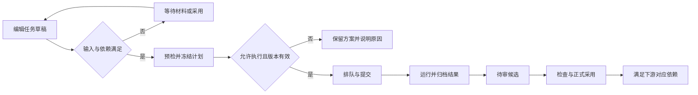

# 生成工作台详细设计

版本：v1.0，2026-10-22。

状态：**主要业务链路已实施，真实生成与独立新手验收待进行**。本文件保留目标规格与验收矩阵；当前实现及边界见下方实施记录和 [系统设计](design.md)，作品进度见 [交接](handoff.md)。不能把目标矩阵中的每一项都视为已经实测通过。

当前合同更新（2026-10-29）：生成不再要求 grant、次数或预算授权。普通制作按[主手册](agent-guide.md#首次一次问清后续按约定推进)首次约定候选数、粗审及返工范围，之后沿用；这是制作偏好，不是新增审批。本文的开发验收矩阵不要求制作Agent每个作品或每次生成重新执行。

实施记录（2026-10-22）：已接入资产/宫格/摄影棚工作台、完整任务清单与真实素材关系画布、动态输入和高级参数、AI 差异建议、冻结计划、显式批次、依赖等待、并发租约、对账、候选回填与采用。互动和生成共用 `components/canvas` 与 `lib/canvasLayout.ts`，不复用剧情图领域对象。新增数据独立保存在 `generation_records`，不迁移或重写作品正文。

代码/合同与模拟服务验收共 56 项定向回归通过，类型检查及生产构建通过。本机实际裁切与视频末帧提取另有测试；浏览器查看桌面/390 px、深浅主题，验证视图切换、固定参考预检、模拟生成、显式采用、分组及刷新恢复。证据在本机 `artifacts/generation-workbench-2026-10-22/`，其中棋盘格是模拟媒体，绝不是作品验收。

尚未验收：真实服务中新可选输入、音频语义、参数组合与宫格指导的生成质量；整场实际视频与切点检查；平板/200% 缩放的完整操作，以及第 17 节要求的独立新手试用。当前目录仅开放 Comfy API 图和已有 KIE 图片/视频适配，其他未接通供应商、任意自定义节点图和独立放大服务不会被伪装成可执行能力。KIE 的未知提交保持对账，不支持未能验证原请求的手动强制关联。

具体作品的修订号、完成状态及暂停以当前项目数据和最新用户指令为准；本设计不携带任何作品的永久暂停指令。

## 1. 目标与确定的产品决策

用户应能从一个创作目标出发，知道系统准备生成什么、用了哪些素材、为何采用这组参数、需要自己处理什么，以及结果将保存到哪里。熟练用户能够自由组织素材和试验；AI 通过正式接口完成相同操作。

确定以下决策：

1. 沿用现有分镜与故事板、摄影棚入口；本场设计、时长分段和宫格是按作品需要使用的工具，不强制走完四步向导。生成工作台是共享工具，不新增一条竞争的顶级制片流程。
2. 提供真正可平移、缩放、连线和分组的素材关系画布；任务清单具备完整操作能力。两者是同一任务数据的视图，切换不复制任务。
3. 参数属于生成任务。分辨率、步数和 LoRA 强度默认不拆成节点。
4. 人物、场景、独立道具各自维护资产；画布引用资产版本，不另建一套素材库。
5. 分镜、叙事时长、生成分段只有现有制片模型一个正式编辑来源。生成面板可以提出调整方案，不能直接覆盖正式分镜。
6. 用户指定的 YZ H3 核心工作流继续作为该项目的约束。支持其他服务是系统能力，不意味着可自动替换本项目核心。
7. 能力按“服务部署 + 模型 + 工作流版本 + 操作方式”确定。多图参考、首帧和宫格指导多镜头分别声明。
8. AI 提案、预检、执行、候选检查和采用是不同动作；同一动作在 UI 与 Agent 接口中使用同一业务规则。
9. 预检形成冻结的计划版本，执行引用该版本。排队、刷新、重试均不重新解释“最新素材”。
10. 普通创作编辑不受技术门禁阻碍；真正发出生成请求、改变正式采用或发生版本冲突时执行必要检查。无需每个步骤弹窗审批。

不纳入本次首版：浏览器内完整编辑任意 ComfyUI 节点、通用自动搜索最佳参数、无人工边界的全自动成片采用、跨供应商无条件自动降级。完整画布、可选输入、允许范围内的高级参数和 Agent 操作均属于本次目标，不能以“后续优化”为由省略。

## 2. 现有基础与需补齐部分

| 范围 | 现有基础 | 本次增量 |
| --- | --- | --- |
| 创作上下文 | `Scene.visualPlan`、Shot、生成单元、宫格及候选 | 工作台绑定这些正式对象和版本，不复制可编辑正文 |
| 生成意图 | `VideoGenerationIntent` 的片段、时间线、参考用途、音频策略 | 增加图像任务的对应意图与统一计划外壳 |
| 模型适配 | `VideoModelAdapterDefinition` 及 Comfy/API 适配 | 按操作方式描述可选插槽、组合和参数约束 |
| 配置 | `AIChannel`、`AIModel`、`ComfyWorkflow` | 核心版本、预设版本、能力快照、旧 ID 映射 |
| 执行 | 持久任务、提交快照、未知提交状态、服务共享并发 | 冻结计划、依赖满足条件、项目执行策略、统一恢复语义 |
| 结果 | 既有媒体、候选与正式采用 | 自动归档到正确目标，绑定完整生成来源 |
| Agent | Operator 能力说明、正式业务 API | 新工作台命令、结构化错误与可执行下一步 |
| 画布 | 已使用 `@xyflow/react` | 复用渲染技术，建立独立生成视图，不复用互动剧情图领域对象 |

源码依据：[`comfyWorkflow.ts`](../packages/domain/src/comfyWorkflow.ts)、[`videoGenerationIntent.ts`](../packages/production/src/services/production/videoGenerationIntent.ts)、[`videoModelAdapter.ts`](../packages/production/src/services/production/videoModelAdapter.ts)、[`comfyUIGateway.ts`](../src/server/providers/comfyUIGateway.ts)、[`videoGenerationTaskRepository.ts`](../src/server/videoGenerationTaskRepository.ts)。

现有 Comfy 网关已经保存提交时的工作流快照，图片/视频已共享同一服务的并发预算；保留并扩展这些实现，不另起第二套供应商队列。

## 3. 页面入口与信息架构

### 3.1 主流程中的位置

| 入口 | 默认展示 | 工作台打开后的范围 | 完成后回到哪里 |
| --- | --- | --- | --- |
| 项目资产 → 生成人物/场景/道具图 | 当前资产及版本 | 指定资产的一次或多次生成任务 | 当前资产候选 |
| 宫格预览 → 生成/修改宫格 | 当前整场或片段的实际画面 | 对应宫格任务、相关资产与候选 | 原宫格、原选中画格 |
| 视频制作 → 制作当前片段 | 摄影棚当前片段与媒体 | 片段视频任务及其参考 | 当前片段媒体池 |
| 任一工作台 → 查看本场任务关系 | 当前场次任务清单 | 展开整场素材关系画布 | 原阶段与原选择 |

沿用现有路由中的 `projectId/episodeId/sceneId/stage/videoUnitId`。拟新增 `generationTaskId` 和 `generationView=list|canvas` 作为可恢复的选择状态，不另建 `stage=generation`。返回、刷新、深链接均保留调用阶段、目标范围与选择。不存在的目标显示“对象已变化”，提供定位当前场次，不默认切到另一片段。

资产级任务必须绑定项目和资产，允许没有场次；制片片段任务必须绑定分集、场次和具体单元。共享资产在多场使用时显示使用范围，不因在某场打开而变成本场专属。

### 3.2 桌面布局

使用现有背景、青色强调、边框、字体与图标体系。采用紧凑工具布局，避免卡片套卡片。

```text
项目 / 分集 / 场次                 本场设计  镜头与时长  宫格预览  视频制作
当前范围：片段 A · 镜头 1–3       [任务清单 | 素材关系]  保存状态 / 生成状态
──────────────────────────────────────────────────────────────────────
任务/本场范围     中央工作区                            所选任务面板
A 联合宫格       清单：任务、引用、结果                  本次目标与范围
B 联合宫格       或                                   AI 建议及依据
C 联合宫格       画布：素材 → 任务 → 候选               参考素材与用途
                 选中结果可直接预览                    输出与声音
                                                      高级参数（收起）
                                                      检查结果 / 下一步
──────────────────────────────────────────────────────────────────────
仅在执行中显示：本场任务进度；全局服务并发从任务状态入口查看
```

不同时显示三个互相重复的场次导航。若宿主页面已提供左侧场次栏，工作台左栏只列本场任务，可折叠。生成工具展开时让出原重复设置面板，同一任务只存在一个有效检查器。

任务卡展示：目标、范围、有效引用缩略图、方案短名称、状态、一个主动作。步骤数等技术参数不堆在卡片标题里。结果卡展示真实缩略图、候选版本、时长或尺寸、检查状态；不存在的结果显示空位，不能用示例图片伪装已生成。

### 3.3 任务清单与画布的操作一致性

| 操作 | 任务清单 | 素材关系画布 |
| --- | --- | --- |
| 选择/取消素材 | 引用列表勾选 | 选任务后勾选、拖入或移除引用边 |
| 替换素材版本 | 行内版本菜单 | 素材卡版本菜单 |
| 设置引用用途 | 引用行中的用途选择 | 引用边或检查器中的用途选择 |
| 调整参数、提示词 | 同一检查器 | 同一检查器 |
| 创建候选、比较、采用 | 结果区域 | 结果卡及同一预览器 |
| 解决超限、缺输入、过期 | 问题行定位到相应字段 | 定位对应卡片与同一字段 |
| 批量执行/暂停 | 勾选任务 | 框选任务；两者生成相同批次清单 |

默认新用户从任务清单进入；记住用户偏好。已在宫格预览的用户仍先看到画面，不能每次进入都被整页参数表替代。展开工作台不丢失原画格选择。

### 3.4 窄屏、键盘和状态

- ≥1280 px：宿主导航、中央区、约 320–380 px 检查器并列，中央保留可用宽度。
- 900–1279 px：折叠任务侧栏；检查器可展开，避免三栏挤压画面。
- <900 px：默认任务清单，检查器使用可返回的单列详情或现有底部面板；可切换只读定位/可编辑画布，所有操作仍有清单入口。
- 支持 390 px 和 200% 页面缩放，表单不横向溢出；窄屏不要求精确拖线。
- 原生按钮、复选框、输入框可通过键盘操作；画布选择与命令有清单等价路径，不能仅靠颜色、悬停或右键。
- 草稿自动保存状态明确为“保存中/已保存/保存失败”；保存失败保留本机恢复副本，不离页丢失。
- 一个任务只显示与当前状态对应的主动作：补齐材料、查看建议、检查配置、生成、查看进度、检查候选、恢复查询。不得多个绿色“完成”并列。

## 4. 核心操作流程

### 4.1 生成联合宫格

1. 从宫格预览选择“本片段”或“整场总览”；总览显示整场时长和视频分组。
2. 系统读取正式本场基准、镜头事件、已采用资产和片段画格需求，创建草稿。缺失的资料列为问题，不编造角色状态。
3. AI 提出资产选择、每份引用用途、宫格布局和生成方案；必须说明为什么需要这些素材。人物、场景和道具数量按内容需要，不固定九格或固定五张参考。
4. 用户可勾选、替换、补充素材，编辑提示词和允许的参数。预览展示最终送入的素材清单与画格顺序。
5. 按首次制作约定提交所选数量的任务，不逐次索要次数、预算或额外授权。
6. 结果自动登记为对应宫格的待审候选。逐格检查身份、空间、状态、揭示顺序及切镜理由；可标问题并定向重做。
7. 采用走既有正式流程，明确影响哪些画格。视频依赖只在采用及当前来源一致后满足。

总览裁切是显式的转换任务，记录原图、裁切区域和目标画格；放大是另一个可追踪步骤。它们都不能被标为“重新联合设计”。模型输入容量不足时提供减少无关参考、调整分组或更换允许的方式，不自动拼成一张图规避计数。

### 4.2 使用宫格与资产生成视频

1. 在视频制作中选择片段。显示镜头范围、计划时长、已采用宫格和未解决问题。
2. 解析项目指定核心和允许的生成方式。当前 H3 宫格方案若仍只有实验依据，显式显示“实验方式”，不能标成正式推荐已验证。
3. 按用途绑定素材：宫格负责该片段画面次序，独立资产负责相关身份或空间；只包含本片段需要的素材。
4. 展示推荐参数及依据。用户手动修改后，建议器只能修改未锁定项。
5. 预检生成固定计划，展示精确的尺寸、请求时长、预计帧数/可覆盖时长、音频策略和素材版本。
6. 执行后归档候选并测量真实媒体；技术成功后仍待检查。播放内部切镜、相邻片段边界、声音和整场节奏。
7. 采用与剪辑沿用摄影棚正式流程；任务成功不自动写入正式时间线。

用户只授权图片或视频处于暂停时，仍可编辑、预检和查看已有结果，视频“生成”入口显示暂停原因。AI 无权把编辑请求解释为解除暂停。

### 4.3 更换服务、模型或生成方式

切换前计算差异，区分：可直接沿用、需要明确转换、不受支持。差异在当前面板展示，不新增全屏审批页。

- 参考数量超限：保留全部选择并标出冲突，用户或 AI 提案明确取舍。禁止静默丢图。
- 参考角色不兼容：例如宫格参考切到首帧，必须选择具体首帧，并说明原多镜头方案不再成立；不把整张宫格当视频首帧。
- 不支持多镜头或时长不合：提出拆分方案，展示镜头顺序和边界，经既有分段保存操作后生成新任务草稿。
- 参数不开放：从当前有效设置中移除，保留在原方案历史中；不能把禁用的 1.5 MP 显示成仍将提交的设置。
- 人工锁定项无法满足：报告冲突，不自动解除锁定。
- 项目指定核心不允许替换：仅能查看其他方案及差异，执行仍受项目约束；用户明确改变项目约束后创建新方案版本。

取消切换恢复完整旧草稿。确认切换创建草稿新版本，旧预检失效；切换回去可恢复原方案值，不复用旧的“已检查”标记。

### 4.4 上游变化、失败与新会话

- 资产、宫格或片段发生相关变化：列出受影响任务；已生成文件与候选保留，显示“来源已变化”。未提交任务重新检查，排队任务进入等待更新。
- 非相关变更，如画布位置或其他场次标题变化，不使当前生成计划失效。
- 提交结果未知：显示“正在核对服务端任务”，恢复查询，不自动另开收费任务。
- 已明确失败：允许“按原方案再生成一个候选”或“修改后生成”；新尝试计入额度。
- 用户主动刷新或新会话接手：读取持久草稿、固定计划、任务状态和项目暂停策略；不要求从聊天恢复 grant；按用户制作指令和实时暂停策略继续。
- 预览成功但正式采用冲突：候选继续保存，提示重新核对当前目标；不覆盖较新的正式稿。

## 5. 无限画布的行为规格

### 5.1 对象和连线

| 对象 | 内容 | 可以编辑 | 不负责 |
| --- | --- | --- | --- |
| 素材卡 | 真实缩略图、资产/候选版本、用途范围、状态 | 选择版本、查看来源；编辑资产跳转正式资产页 | 复制资产领域对象或把多人图拆成虚假独立资产 |
| 生成任务卡 | 目标、计划范围、有效方案、状态、主动作 | 引用、提示词、允许参数、执行计划 | 直接修改正式剧本或分镜 |
| 处理任务卡 | 裁切、提取实际帧、放大等明确操作 | 操作范围与参数 | 冒充 AI 联合生成或实际画面检查 |
| 结果卡 | 一次执行的一个媒体输出及候选状态 | 检查记录、比较、采用命令 | 覆盖旧结果文件 |
| 分组框 | 场次/片段/试验分支的视觉组织 | 名称、折叠、位置 | 决定播放顺序或执行顺序 |

生成/处理任务是同一计划机制下的不同操作，不能只因画布出现“放大”卡就自动获得对应服务能力。首版支持已接通的处理操作，未接通操作只出现在能力设置中。

引用边携带 `bindingId、输入角色、目标范围、选择的素材版本、可用条件`。工作台层允许“素材或结果 → 任务”“任务 → 结果”；未产生结果的依赖边使用明确输出槽位。不得出现任务直接引用未知的“最新输出”。

### 5.2 编辑与导航

- 进入时聚焦当前任务及一跳引用；提供“适合当前任务”“查看本场”与缩放恢复。
- 支持平移、滚轮/触控板缩放、框选、拖拽卡片、自动排列、折叠分组；节点移动只改变布局。
- 从项目资产拖入当前任务时创建引用；拖到空白处仅建立可选素材卡，不自动提交给所有任务。
- 一份素材可服务多个任务，边上的用途可以不同；勾选或移除只影响当前任务。
- 手动连线必须选择或确认输入角色。可确定的角色自动填入并可见，不能依据左右位置猜输入顺序。
- 删除引用边是修改草稿，触发预检失效；命令叫“移除此引用”。移出无引用素材卡只影响视图，命令叫“从画布隐藏”。不使用一个含糊的删除键同时执行两种行为。
- 归档任务与删除素材分离；归档前显示仍运行的任务和依赖，不删除历史执行。运行中任务不能通过移出画布停止。
- 复制任务默认复制为草稿，保留来源但生成新 ID，不执行、不复制采用状态。
- 撤销/重做只覆盖草稿和布局操作，不能撤销已经发给供应商的请求。正式采用用现有版本历史恢复。
- 循环依赖在保存边时拒绝，定位形成循环的任务；独立分支可并行。

### 5.3 布局与持久化

按场次保存布局和分组，按用户保存视口/选择偏好。资产位置与运行参数分开存储，拖动不能更新 `productionRevision` 或计划哈希。大量节点按当前范围裁剪、按需加载缩略图，切换场次不加载整部剧的全部视频。

业务节点状态由任务/结果读模型派生，画布 JSON 只保留稳定 ID 和位置。任务清单与画布使用同一命令与事件源；禁止双写两份业务模型。

## 6. 检查器、AI 建议和参数控制

### 6.1 默认与高级内容

默认区按顺序显示：本次目标与范围 → 推荐方案及依据 → 参考素材 → 输出画幅/像素尺寸/时长 → 声音方式 → 问题与主动作。提示词可直接展开编辑，并区分系统整理与人工覆盖。

内容类型与制作目标独立：

- 内容特征：对白、动作、混合、其他。由场次提出建议，用户可纠正。
- 制作目标：快速试验、正式制作。它们表示配置偏好，不是质量通过状态。
- 推荐服务：从允许且兼容的配置中选取；没有符合项时说明缺哪种能力。
- 耗时、费用只展示有来源的估计范围和时间；无记录则显示未知，不能照抄作者演示耗时。

高级区由能力定义驱动：采样、二采、种子、参考处理、LoRA 开关与强度、分块/卸载等。参数没有可用映射或服务不开放时不出现在有效表单中；详情可以说明不可用原因。

### 6.2 参数定义与覆盖规则

每项参数定义至少包含：稳定键、中文名、类型、单位、默认值、允许值/范围、显示条件、启用条件、跨字段约束、是否派生、是否可由 AI 调整、是否可由用户调整、实际供应商映射和说明来源。

优先规则：

1. 项目约束与核心不可变项优先，任何值都不能突破。
2. 人工锁定的字段/引用不能被预设或 AI 改写；不合法时报告冲突。
3. 人工覆盖值默认保留。应用新预设时只展示会改变的覆盖项，让用户一次选择保留或替换；不逐字段反复确认。
4. AI 建议以差异补丁呈现，只填未覆盖的值或建议修改；禁止隐藏覆盖。
5. 未设值按预设、核心默认值依次解析。派生值最后计算，不能独立填写另一份矛盾结果。

锁定粒度包括具体参数、素材绑定、选择的核心和方式；“手动改过”不等于全部锁定。每项记录 `source=default|preset|ai|user`、来源版本、是否覆盖、是否锁定。用户可单项“恢复方案值”或“解除锁定”。修改工作流核心只能另存版本，原版本不可变。

系统提示词中的来源/范围/状态约束采用结构化生成方式；人工编辑自由文本不能无声删除当前任务必需的技术映射。若用户确实要改创作意图，则生成新草稿并重新检查。

### 6.3 YZ H3 参数的具体呈现

| 参数 | 用户看到的内容 | 校验/限制 |
| --- | --- | --- |
| 核心工作流 | YZ H3，明确版本与服务适配来源 | 核心节点、模型及必需加速/放大链路保留 |
| 总步数、一采步数 | 高级区分别输入，旁边显示二采步数 | 二采 = 总步数 − 一采；整数与范围由模式能力定义 |
| 一采尺寸比例 | 比例以及计算后的近似宽×高 | `0.6` 是宽高比例，像素量约 36%；最终尺寸还需节点对齐 |
| 最终分辨率 | 实际宽×高为主，MP 为补充 | 画幅、像素量、对齐倍数及资源约束联动 |
| 融合/动作/速度 LoRA | 文件身份、是否启用、强度及建议范围 | 只开放已声明的可调项；开关和强度分别记录 |
| 放大模型、分块、卸载 | 当前有效值与高级说明 | 必须与模型、采样节点和部署兼容 |
| 种子 | 随机或指定 | 随机种子在预检冻结时确定并持久化，排队时不重新随机 |

10/6、12/6、8/4 是已有参考方案，不代表所有内容的最优值。原文件、作者讲解与当前服务适配存在差异，按 [YZ H3 记录](comfyui-yz-h3-production.md) 标注来源。新的可选参考组合需编译和测试，不能仅改图片数量校验。

## 7. 时长、宫格和连续性

### 7.1 时间的唯一归属

| 时间 | 归属 | 可否在生成检查器直接改变 |
| --- | --- | --- |
| 镜头叙事时长、切点、单元范围 | 正式 Shot / 生成单元 | 不能覆盖；提出修改方案，回到“镜头与时长”保存 |
| 请求时长 | 冻结生成计划 | 可调整，但必须校验对叙事覆盖与服务能力的影响 |
| 编译预计时长/帧数 | 模式适配器计算结果 | 只读 |
| 实际媒体时长 | 媒体测量 | 只读，不能拿请求值代填 |
| 剪辑取用区间 | 摄影棚时间线 | 在剪辑中编辑，不修改原媒体 |

请求变长可用于合理前后余量，需显示取用区间和对应时间映射；请求变短不足以覆盖动作/对白时阻止该方案执行，允许重新分组。不能自动加速、删对白或定格补足。

### 7.2 当前指定 H3 的对齐

以下仅描述当前适配记录，不推断为所有 H3 服务的通用规则：单次上限 14 秒，按当前记录使用 `17n+5` 帧、24 fps。可编译帧数必须同时满足服务限制和计划覆盖。

- 12 秒请求可能编译为 294 帧，约 12.25 秒；预检展示实际对齐及剪辑取用范围。
- 14 秒请求若向上对齐到 345 帧约 14.375 秒，超过当前限制，不可提交。
- 上限内 328 帧约 13.667 秒，不能声称完整覆盖 14 秒叙事；应调整分段或请求方式，不默默缩短。
- 若部署规则改变，产生新能力版本并重新验证，不沿用旧计算结果。
- 输出后测量实际时长；超出允许上限或短于必须覆盖范围，候选标技术问题，正式采用被相应规则阻止。

### 7.3 参考范围与场内统一

每个视频计划冻结本场空间/光线基准、相关角色道具状态、片段起止状态、镜头/画格对应、切镜依据和引用版本。跨场引用必须说明继承或变化，不能把邻场内容混入本场。

参考至少区分：整场总览、本单元宫格、单镜关键帧、实际视频提取帧。整场总览不能直接作为超时单次视频参考；只有选定本单元范围并形成明确输入后才能提交。

边界连接可采用共同资产、计划画格或真实视频边界帧，三者标注不同来源。只有必须依赖真实上游视频结果的任务串行等待；共享已确认资产和计划的独立单元可以并行。场内统一仍以实际相邻切点和整场播放验收，不追求所有镜头动作无缝连接。

## 8. 生成能力与适配器合同

### 8.1 生成方式不能互相推导

内部方式标识至少区分：`text_to_image`、`reference_image`、`joint_storyboard`、`image_edit`、`text_to_video`、`first_frame_video`、`first_last_video`、`reference_video`、`board_guided_video`、`extract_frame`、`crop`、`upscale`。

这是系统任务词汇，不表示每个模型都支持。适配器只公布实际实现的方式。`board_guided_video` 需要具体工作流接线及用法证据；`reference_video` 或 `multiShot=true` 不能自动推出该能力。

输入角色可包含人物身份、环境、独立道具、风格、构图、宫格次序、首帧、尾帧、动作视频、音色、完整对白和节奏参考。音色、完整对白与原生声音输出分别声明。

每种方式定义：

- 槽位及允许角色、媒体类型、必需/可选、数量、顺序、文件大小/时长/尺寸限制。
- 互斥或依赖条件，例如首尾帧与普通参考是否可混用、参考视频是否必须同时带源音频。
- 请求时长的连续范围或离散集合、帧数与尺寸对齐、画幅、输入总额度。
- 允许参数及跨字段限制，例如二采步数、分辨率×时长组合、音频同步要求。
- 编译行为、可选分支的启停规则、实际输出节点和输出种类。
- 验证来源、部署指纹、测试范围和已知失败。

### 8.2 能力证据

证据分别记录，不使用一个笼统“已验证”勾选：

| 证据层 | 证明什么 | 不能证明什么 |
| --- | --- | --- |
| 文档/节点声明 | 服务或节点暴露此输入/参数 | 当前部署已安装并可运行 |
| 静态编译检查 | 映射、分支和本地限制符合合同 | 服务器一定成功执行 |
| 实际服务试跑 | 指定部署和配置成功返回目标媒体 | 任意参数组合或创作内容都合格 |
| 作品用法检查 | 指定样例的身份、切镜等检查结果 | 模型以后永不出错 |

证据包含时间、核心/适配器/部署版本、参数组合、素材类型数量、结果 ID 和检查结论。出现新的已知失败需保留，不用成功次数覆盖失败。

正式推荐优先选择目标用法有实际证据的方案；只有声明的方式放入实验区。用户可显式选择实验方式，生成结果仍待审；AI 不能把实验标签自行升级。

ComfyUI 节点信息只用于发现输入和部署差异。`/prompt` 是执行入口，不是免费的预检接口。线上 API 未开放的采样参数不能合成一个看似通用的表单。

### 8.3 可选输入编译

编译器按角色绑定映射到明确槽位，不依赖画布坐标或对象遍历顺序。删除可选输入时，同时关闭或重接相关节点分支；不填重复图片、空文件名或作者本地示例路径。

每个能力版本使用确定性的转换规则和允许节点清单。AI 只能修改公开参数及合法引用，不能随意生成节点 ID、执行任意工作流或读服务器路径。工作流维护入口可以导入和验证新核心，普通任务界面不承担完整节点编辑。

### 8.4 服务与工作流维护界面

创作者在任务里选“生成方案”，维护者在现有设置页管理以下四个对象，不把全部配置混成一个模型下拉框：

| 设置对象 | 列表主要内容 | 编辑时必须说明 |
| --- | --- | --- |
| 服务连接 | 名称、地址、启用状态、连接检查、资源池/并发 | 连接可用仅证明认证/接口访问；生成、上传、下载是否实测分别显示 |
| 模型部署 | 服务中的实际模型、可用任务类型、版本 | 模型名称与任务别名分开，不能将预设名称伪装成不同模型 |
| 工作流核心 | 原始文件来源、当前核心版本、适配器、可用方式、验证状态 | 原文件与服务适配版的差异、关键模型/LoRA/放大链路及输入输出映射 |
| 参数方案 | 适用核心/方式、内容特征、制作目标、有效参数、证据 | 从哪个版本派生，哪些是人工修改，是否实验或仅供历史查询 |

导入核心的过程是“读取文件 → 识别格式 → 解析节点/旁路 → 绑定输入输出 → 声明可调参数 → 静态检查 → 保存待验证版本”。原始画布 JSON 与 API 执行图分别保存来源摘要；遇到不支持的前端专用节点、开关或动态端口，明确报出未解析项，不猜测接线。

参数映射维护界面提供节点输入选择及服务返回的类型约束，AI 可以提出映射建议，保存前由确定性校验核对。核心差异视图突出模型替换、LoRA 启停/强度范围、采样链路、放大模型和输出节点。服务器文件名适配必须留映射记录，不宣称文件与作者原版逐字节一致。

静态检查通过可以保存版本，不能自动升级为可推荐；真实试跑遵守用户指令与项目暂停策略。用户指定核心项目的推荐列表只包含该核心允许的模式/参数方案。没有符合能力的方案时，显示具体缺项和“查看生成设置”，不以诊断版本自动补位。

预设名称供人理解，业务引用必须使用不可变 ID/版本；重命名不改变历史含义。停用服务阻止新执行，历史任务仍可查询；如果连接地址改变，运行任务继续绑定原服务身份，不能把原任务 ID 发给新地址。

## 9. 数据模型与唯一来源

### 9.1 对象职责

| 对象 | 内容与生命周期 | 与现有数据的关系 |
| --- | --- | --- |
| `GenerationRecipeRevision` | 不可变核心图或 API 编译定义、参数策略、输出合同 | 由现有工作流/API 适配版本派生，不保存密钥 |
| `GenerationPresetRevision` | 兼容核心、内容/制作目标、默认参数、证据引用 | 替代反复复制的参数型模型配置，保留旧映射 |
| `GenerationCapabilitySnapshot` | 指定部署、方式、约束和证据 | 作为适配器可公开读模型 |
| `GenerationTaskDraft` | 可编辑目标、输入绑定、参数覆盖、依赖；乐观版本 | 引用正式制片对象，不另写分镜正文 |
| `GenerationPlanRevision` | 预检后不可变的有效输入、意图、参数和编译摘要 | 包装现有视频意图/计划；图像有对应合同 |
| `GenerationDependency` | 上游任务输出槽、固定结果版本、角色、满足条件 | 解决尚未生成素材，不能用虚构 URL 占位 |
| `GenerationExecution` | 一次执行的计划版本、额度、供应商任务与状态 | 关联现有持久供应商任务，复用执行器 |
| `GenerationResultBinding` | 实际媒体、技术测量、目标候选 ID、来源 | 候选/采用状态以现有正式业务对象为准 |
| `GenerationPolicy` | 项目暂停、指定核心与实验方式 | UI/AI 共用服务端策略检查；旧 Grant 仅在主动引用历史授权时兼容 |
| `GenerationCanvasLayout` | 业务 ID、位置、分组；用户视口另存 | 不包含业务参数，不影响作品版本 |

### 9.2 关键字段草案

以下为设计伪类型，具体实现通过共享 schema 生成运行时校验，不以 TypeScript 声明替代服务端校验。

```ts
type GenerationTarget =
  | { kind: 'asset'; projectId: string; assetId: string; variantId?: string }
  | { kind: 'board'; projectId: string; episodeId: string; sceneId: string;
      boardId: string; pageId: string; shotIds: string[] }
  | { kind: 'video_unit'; projectId: string; episodeId: string; sceneId: string;
      unitId: string; shotIds: string[] };

type DraftReference = {
  bindingId: string;
  source: { kind: 'media_version'; mediaVersionId: string }
        | { kind: 'task_output'; taskId: string; outputSlotId: string;
            resolvedResultId?: string };
  role: string;
  targetShotIds?: string[];
  order: number;
  enabled: boolean;
  requiredByMode: boolean;
  sourceOfChoice: 'preset' | 'ai' | 'user';
  locked: boolean;
  availability: 'generated' | 'adopted_current' | 'measured_frame';
};

type GenerationPlanRevision = {
  id: string; schemaVersion: string; taskId: string; draftRevision: number;
  target: GenerationTarget;
  sourceRevision: number; relevantSourceHash: string;
  recipeRevisionId: string; presetRevisionId?: string;
  capabilitySnapshotId: string; adapterVersion: string;
  connectionId: string; deploymentFingerprint: string; mode: string;
  intentSnapshot: unknown;
  references: Array<{ bindingId: string; mediaVersionId: string;
    contentHash: string; role: string; providerSlot: string; scope: unknown }>;
  resolvedParameters: Record<string, unknown>;
  parameterProvenance: Record<string, unknown>;
  timing?: { narrativeSeconds: number; requestedSeconds: number;
    compiledFrames?: number; fps?: number; expectedSeconds?: number;
    beatMapping: unknown; plannedTrim?: unknown };
  compiledRequestHash: string; planHash: string;
  estimate: { cost?: unknown; duration?: unknown; evidenceIds: string[] };
};
```

`requiredByMode`、允许的角色及输出目标由服务端生成/验证，客户端不能把必需项改为可选绕过规则。`intentSnapshot/beatMapping` 实施时使用明确的图像/视频联合类型，不能长期保留 `unknown`。

来源哈希使用与生成实际相关的文本、状态、画格映射和引用，而非整个项目 JSON。正式采用仍检查当前 `productionRevision` 并走冲突合并；其他无关编辑不会无意义地要求重新生成。

### 9.3 持久化与事件

新增草稿、计划版本、依赖、执行包装、策略/额度、布局和兼容映射的存储，采用 SQLite 事务与版本比较。候选与媒体继续在现有体系中维护，不双写第二份“采用状态”。

执行完成写入“待登记结果”事件，由可重入处理器调用既有候选保存用例；以 `executionId + outputSlotId + mediaHash` 去重。崩溃后可重放登记，不能再次生成。候选登记成功后投影到任务读模型；跨表更新采用事务或持久事件，禁止只依赖浏览器回调。

草稿修改使用 `expectedRevision`；冲突返回最新版本和字段差异，保留本地草稿。布局使用独立版本，不与制作草稿争用一个版本号。保留创建者/修改者类型与命令 ID，便于分辨 AI 提案和人工改动。

## 10. 预检、冻结与执行协议

### 10.1 预检顺序

1. 校验请求主体、目标身份、草稿版本与可访问范围。
2. 读取正式来源，检查目标仍存在、范围一致；解析依赖并绑定具体结果。
3. 解析核心、预设与人工覆盖，检查不可变项和锁定冲突。
4. 解析当前部署能力，检查方式、角色组合、时长、尺寸、声音及跨字段限制。
5. 冻结每份媒体的实际内容版本/哈希。外部可变 URL 必须先导入本地媒体版本，不能只哈希 URL。无法取到内容时不得形成可执行计划。
6. 生成最终提示词、供应商输入槽位、实际尺寸/帧数及随机种子；验证无遗漏、无未声明输入。
7. 保存不可变计划版本和预检收据，返回有效设置、问题、估计及下一动作。

本地预检不发生成请求、不上传创作素材给新供应商、不消耗生成额度。可以使用只读能力查询。供应商明确提供无生成的验证接口时，通过适配器显式声明其行为；不能把普通生成接口当试检。

存在阻断问题时保存草稿与诊断，但不返回可执行收据。创作风险可以是提醒，例如动势复杂尚无验证案例；已暂停、输入缺失、范围矛盾、引用未满足及来源冲突是执行阻断，仍允许编辑。

### 10.2 摘要与收据

`planHash` 覆盖目标范围、相关来源摘要、素材内容、角色顺序、核心/预设/适配器/能力版本、有效参数、最终提示词和时长映射。采用稳定序列化；排除画布坐标、展示名、密钥与生成时间戳。

`compiledRequestHash` 覆盖编译模板和逻辑槽位绑定。供应商上传文件名属于执行时传输信息，由执行记录补充实际请求摘要，并证明它们对应冻结的内容哈希；不因临时上传名不同改变创作方案。

预检收据引用计划、校验规则版本及能力检查时间。执行前重验政策、来源与部署指纹；耗时较久的只读能力信息可自动刷新，但不能自动换模型或参数。检查通过不等于授予生成权限。

### 10.3 提交与冻结后的变化

执行请求只接受 `planRevisionId + planHash + idempotencyKey`，不接受夹带新参数。服务端比较方案内容与最新执行条件，在事务内创建执行记录，然后排队。

- 草稿发生变化但请求指定旧计划：显示原计划版本；默认要求使用当前草稿的计划。显式重做旧方案属于单独命令，不假装最新。
- 相关正式来源发生变化：未提交执行暂停，返回差异。可更新计划；如需保留旧版实验，明确标为历史实验候选，不能直接采用到当前范围。
- 核心/服务配置更新：冻结版本仍可运行且部署匹配时按原版本执行；部署已不能满足时等待修复或创建新方案，不自动替换。
- 已发出的请求不会被后续编辑改写，返回结果继续归档并标明原来源版本。

## 11. 状态、依赖和候选采用

将三个维度分开保存，不能用一个 `status=ready` 同时代表它们。

| 维度 | 状态 | 解释 |
| --- | --- | --- |
| 计划可执行性 | draft / waiting_inputs / invalid / validated / stale | 依据当前草稿、依赖和预检派生 |
| 一次执行 | queued / held / submitting / running / reconciling / succeeded / failed / cancelled | 是否发给供应商、是否明确得到结果 |
| 结果检查 | pending / needs_changes / adopted / source_changed | 以现有候选检查与采用规则为准 |

`held` 附原因：项目暂停、来源变化、额度不足、等待恢复等；执行额度队列已满仍是 queued。`reconciling` 映射现有未知提交状态；它不是失败。



依赖边的条件由方式规定：宫格到正式视频通常为 `adopted_current`；实际尾帧必须是指定执行结果完成测量并提取的 `measured_frame`；技术转换实验可在明确范围内使用 `generated`。实验输入不会自动升级为正式采用。

下游只有在所有必需边满足后才能预检冻结；上游生成成功可以自动刷新准备状态，但不能把“最新候选”绑定后直接执行。批次自动续行仅针对显式提交且固定计划已具备的任务；新增输入或版本变更需要形成新计划，不能沿用旧收据。

上游候选通过正式采用后，显式加入等待队列的下游任务重新预检，通过后执行；不需要另建范围委托。来源、锁定和暂停检查不变，任务修改后停止旧等待记录，重新加入才继续。

上游失败不将下游标为生成失败，而标为等待上游修复。取消一个任务不自动取消独立任务；取消批次显示待提交、运行中、已完成的数量，分别处理。

## 12. 直接执行、暂停、并发与恢复

### 12.1 执行策略

项目持久策略区分图片与视频暂停、用户指定核心及实验方式。用户发出制作指令后，人和外部 Agent 都可直接执行预检通过的计划；不要求填写媒体类别、服务、次数、预算或有效期授权表，不要求 grantId。

页面按“检查并准备生成 → 生成”操作；批量选择实际任务后直接提交。显式加入等待队列的任务待依赖就绪后重新预检。生成和正式采用保持分离，不把调用成功当作画面已合格。

旧 fixed_plans / bounded_scope 记录仅为历史执行兼容。主动携带旧 grantId 的请求继续遵守旧约束；新请求无需创建或传入。旧队列不得因本次改动自动扩大或恢复撤销项。

需要取消暂停时使用明确命令并更新策略版本。普通“继续编辑”“帮我设计”以及另开会话不会解除暂停。恢复只让条件满足的任务可被调度，不自动提交新的任务。

费用未知时可显示“暂无可靠估计”，但不要求用户填写预算或勾选费用授权。记录真实服务返回的用量，不能编造价格。

明确无按次计费的自托管连接标为“不按次计费”，仍受服务实际并发限制；不虚构价格，也不为每次内部运行增加金额确认。

### 12.2 执行检查时点

创建执行、出队、素材上传前，以及实际向供应商提交前检查暂停、来源和工作流策略；实际提交前再次检查策略版本及相关来源。执行器取得短期调度租约，通过幂等执行和共享并发队列，避免多个标签页/AI 重复提交。

暂停阻止尚未跨越提交边界的任务。已在网络提交中的请求无法保证撤回：显示“正在提交/正在核对”，允许尽力取消，不谎称已停止。已运行任务仍查询、归档结果；取消成功需供应商状态证实。

旧直接生成入口也必须进入同一执行边界或只允许查询历史任务。不能只给新页面加检查，留下 Agent 可直接绕过的旧 POST 路由。

### 12.3 并发与调度

复用现有服务预算调度。当前用户确认的 Comfy 服务额度是图片与视频合计 7 路，不能按预设或模型分别放大。新连接从实际配置读取限额，不全局写死 7。

同一实际执行资源池即使有多个连接别名也共享限制，保留现有按 origin 归并的行为，并引入显式 `executionPoolId` 处理账号/集群差异。若资源池身份不明，保守共享，不假定独立容量。多进程扩展时使用数据库租约，不能仅靠内存计数。

429 按服务返回退避，不新建候选。跨场次可公平排队；小任务不应长期被单个大批次占满。来源变化或暂停的 held 任务不占未提交的执行槽位，已经可能提交的未知任务默认继续占用保守额度。实际核对远端队列及覆盖提交时段的历史、未发现对应在途任务后，人或Agent可显式释放本地占位并记录核对证据和身份。不按超时自动释放，不改未知状态、不取消或重发旧任务；以后验证关联了上游编号，在途任务立即重新计入容量。后台事务派发和轮询调度使用同一占位规则。

### 12.4 恢复语义

| 用户动作 | 标识与内容 | 会不会发起新生成 |
| --- | --- | --- |
| 恢复查询 | 原 execution、原 providerTaskId | 不会 |
| 安全恢复尚未提交的执行 | 原计划与幂等键，确认未到提交边界 | 可以继续原执行，不算新候选 |
| 再生成一个候选 | 新 execution、明确 seed 策略、消耗新尝试 | 会 |
| 修改参数后生成 | 新草稿/计划版本、新 execution | 会 |
| 查询提交结果未知 | 原执行进入对账 | 不自动另起任务 |

同一幂等键绑定同一计划摘要；不同内容返回冲突。供应商支持幂等时继续传递稳定标识，不支持时承认无法保证网络故障下的恰好一次，使用本地状态、服务历史和人工核对避免盲目重发。

“按原方案再生成”默认保留全部参数并明确种子；“生成新变化”生成新种子并形成新计划。不能声称完全复现模型随机或非确定性运行。

## 13. UI 与 Agent 共用命令/API

以下路径为拟议新接口。现有 `/api/operator/capabilities` 与 handbook 发布实际可用版本后，Agent 才可调用；设计文档不能当作已上线接口清单。

| 操作 | 拟议接口 | 必需输入/返回 |
| --- | --- | --- |
| 查询可用方式 | `GET /api/production/generation/capabilities` | target、operation；返回方式、约束、证据、不可用原因，不返回密钥 |
| 读取工作台 | `GET /api/production/generation/workspaces/:id` | 返回正式上下文摘要、草稿、依赖、状态、允许动作 |
| 创建草稿 | `POST /api/production/generation/tasks` | target、operation、来源版本、commandId；返回草稿 revision |
| 修改草稿 | `PATCH /api/production/generation/tasks/:id` | expectedRevision、typedPatch、commandId；不接受任意 JSON 路径 |
| 获取 AI 建议 | `POST /api/production/generation/tasks/:id/proposals` | 当前草稿版本、目标；返回差异、理由、证据，不直接改稿 |
| 应用建议 | `POST /api/production/generation/tasks/:id/apply-proposal` | proposalId、expectedRevision、选择项；重验锁定和能力 |
| 预检 | `POST /api/production/generation/tasks/:id/preflight` | expectedRevision；返回 planRevisionId、planHash、receipt、issues |
| 执行计划 | `POST /api/production/generation/executions` | 固定计划、摘要、idempotencyKey |
| 批次执行 | `POST /api/production/generation/batches` | 显式计划清单及各自摘要、idempotencyKey |
| 读取/恢复/取消执行 | `GET /.../executions/:id`、`POST /.../:id/reconcile`、`POST /.../:id/cancel` | 返回真实状态、可采取动作、禁止盲重试原因 |
| 设置生成策略 | `PATCH /api/production/generation/projects/:id/policy` | expectedPolicyRevision；角色检查，暂停与解除分别表达 |
| 等待任务依赖 | `POST /api/production/generation/queue` | taskIds、commandId；不需要 grant |
| 查看/检查/采用结果 | 复用既有候选业务用例，由结果绑定返回入口 | 当前制作版本、候选 ID；保留既有采用权限与校验 |
| 保存布局 | `PATCH /api/production/generation/workspaces/:id/layout` | expectedLayoutRevision、节点位置，不含生成参数 |

批次提交先整体校验清单与额度，再创建批次；有不可执行项时默认返回清单，不偷偷执行部分。用户选择“只执行这 N 个”后提交明确子集。执行过程可能部分成功，逐项显示，不谎称事务式撤回供应商工作。

所有命令使用相同应用服务；Operator 工具只是命令包装，不复制校验。返回 `allowedActions` 使 AI 知道应修输入、重新检查、等待采用还是恢复查询。

错误采用机器码和可读消息，例如：

```json
{
  "code": "REFERENCE_ROLE_REQUIRED",
  "message": "当前方式需要片段 A 的宫格参考，已选人物图不能替代。",
  "scope": { "taskId": "example-task-a", "field": "references" },
  "blocking": true,
  "allowedActions": ["select_board_reference", "propose_mode_change"],
  "retryable": false
}
```

另需稳定错误码：`DRAFT_CONFLICT`、`SOURCE_CHANGED`、`CAPABILITY_CHANGED`、`LOCKED_FIELD_CONFLICT`、`DURATION_COVERAGE_GAP`、`DEPENDENCY_NOT_ADOPTED`、`GENERATION_PAUSED`、`GRANT_SCOPE_MISMATCH`、`BUDGET_UNAVAILABLE`、`IDEMPOTENCY_CONFLICT`、`SUBMISSION_UNKNOWN`。不能把所有失败统一返回“请重试”。

AI 建议流程固定为：读目标及允许动作 → 查询兼容方式 → 提案并应用允许的改动 → 预检 → 直接执行固定计划 → 查询/对账 → 报告实际结果与问题 → 按正式权限检查/采用。生成权限不等于采用权限，任务成功不能被模型自行写成视觉验收通过。

## 14. 来源变化与正式回填

| 变化 | 草稿/未提交计划 | 已执行候选 | 正式成果 |
| --- | --- | --- | --- |
| 画布位置、折叠状态 | 不失效 | 不变 | 不变 |
| 同范围人物/场景资产版本 | 显示差异，更新后重检 | 保留，标来源变化 | 标复核，不删除 |
| 切点、镜头范围或叙事时长 | 重建时间映射，必要时重新分段 | 保留历史范围 | 正式保存校验，不自动重绑定 |
| 核心或有效参数变化 | 新计划版本 | 原计划快照保留 | 原来源保留 |
| 新候选出现但未采用 | 当前固定引用不变 | 新旧并存 | 不变 |
| 替换已采用宫格 | 依赖需重新确认版本 | 原引用保留并标变化 | 保留媒体，检查受影响范围 |

结果归属按冻结目标和稳定 ID 确定，不能以“当前页面选中的镜头”决定。若目标已删除或拆分，结果进入该项目的“待重新关联”清单；只有明确完成范围映射后才可采用，不丢弃媒体。

正式采用使用既有保存/QA/版本流程。回填记录执行 ID、计划摘要、媒体版本、检查证据与对应目标；不直接修改数据库伪造采用。引用链能从最终视频追溯到宫格、人物/场景资产和具体参数版本。

## 15. 迁移与兼容

迁移分为盘点、影子映射、切换新写入、历史兼容四步；先对配置做可恢复快照。不会删除现有模型、工作流、任务或候选。

1. 枚举现有配置，按节点拓扑、模型文件、映射、核心参数和输入方式生成指纹。只在已证明同核心且差异属于允许参数时合并为预设。
2. 首帧与多模态参考方式按能力区分；同核心的三图、四图示例统一到可选输入的 H3 多模态适配，旧 recipe ID 保留供历史任务复现。未知工作流不因名称含 H3 自动归并。
3. 创建 `legacyModelId/legacyWorkflowId → recipeRevisionId/presetRevisionId/modeId` 固定映射；没有足够信息的配置保留 legacy 模式，不猜测。
4. 默认选择器只显示兼容推荐及用户自建方案；诊断配置放入“实验与历史”，历史仍可查看原名与原快照。
5. 新任务走统一计划与执行边界，旧正在运行任务继续使用原快照和供应商 ID 查询，禁止迁移时重新提交。
6. 历史记录缺乏哈希/证据时标“历史来源信息不完整”，不能补造“已验证”。需重用时重新建立媒体版本与计划。
7. 旧 UI/Agent 的新生成调用适配到同一策略与计划检查；不能留下不检查暂停的直通入口。
8. 开关控制新界面启用。回退界面不回退执行策略，不丢失新候选；不能回滚到会忽略暂停的新请求入口。

迁移保留当前项目暂停状态与历史成果，不由通用设计替某个作品选择修订版本。制作偏好读取项目约定；已有用户指令不重复询问。

## 16. 实施包与完成条件

每个实施包完成后都有可验证结果；阶段划分服务于交付顺序，不能把最终目标缩成一个能展示的表单。

| 包 | 工作内容 | 主要落点（拟议新增路径） | 完成条件 |
| --- | --- | --- | --- |
| A 领域与兼容 | 目标、方式、参数、引用、版本、旧映射 schema | `packages/domain/src/generation/`；扩展现有配置与适配定义 | 不改正式数据；固定/可选输入、时间与核心约束有用例 |
| B 计划与执行 | 草稿、预检冻结、策略、额度、恢复、结果登记 | `packages/production/src/services/production/generation/`；`src/server/generation/`，复用 providers/repository | UI/Agent/旧入口均不能绕过暂停、版本和重复提交检查 |
| C 任务面板 | 嵌入资产、宫格、摄影棚；完整清单、引用和高级参数 | `src/components/generation/`；现有 Storyboard/Studio 宿主；`src/clients/generationClient.ts` | 不用画布能完成标准流程，来源和差异可理解 |
| D 关系画布 | 真实平移缩放、连线、共享引用、分组、比较、布局恢复 | 同一 generation 前端功能目录 | 两视图命令一致，连线不绕过规则，键盘/窄屏有等价入口 |
| E Agent 与服务验证 | Operator 命令、允许动作、H3 与一种已有线上 API | 扩展 `src/services/operator/` 与当前适配器 | 同一目标经 UI/AI 形成一致有效输入，真实边界案例留证据 |
| F 迁移与作品验收 | 配置兼容切换、历史恢复、整场制作验证 | 配置迁移与定向验收工具 | 历史可追溯，运行任务不重复，真实成片检查另行记录 |

保持当前模块化单体。新增领域逻辑进入 packages，页面宿主和服务器接线沿用当前 owning 模块；本次不夹带整个根目录迁移。原生图片/API 路径都需进入统一计划外壳，不能只把视频改完。

A–D 可以使用隔离数据和模拟服务完成开发验收。E/F 的真实生成必须等用户明确解除对应暂停并给出范围，不能以“测试”绕过暂停。真实服务测试先验证指定核心，再增加允许的可选输入和参数组合，不通过大量无目标试跑找答案。

## 17. 验收矩阵

以下是完成标准，不是本轮已经通过的测试。自动测试使用临时数据库和模拟服务；真实服务与创作检查分别留证据。

| ID | 场景 | 必须观察到的结果 | 层级 |
| --- | --- | --- | --- |
| UX-01 | 新手从宫格页制作本片段 | 保留场次/画格，知道下一步和保存位置 | 实际用户 |
| UX-02 | 只使用任务清单 | 可选素材/版本、改参数、检查、生成、比较和采用 | UI |
| UX-03 | 同一任务切换视图并刷新 | 数据一致、没有重复任务、恢复目标和草稿 | UI/HTTP |
| UX-04 | 390 px、平板、桌面、深浅色、200% 缩放 | 无关键操作丢失、无表单溢出，不强迫拖线 | UI |
| UX-05 | 默认参数面板 | 无需理解 10/6 或 MP 就能完成标准操作 | 实际用户 |
| REF-01 | 历史固定三图工作流只提供两图 | 指出该版本不支持；不能靠放宽校验强行通过 | 单元/服务 |
| REF-02 | 新可选插槽模式取消一路 | 编译正确关闭分支，实际未上传未选素材 | 编译/服务 |
| REF-03 | 宫格模式移除宫格，只留人物图 | 提示缺少次序参考或显式变更方式 | 单元/UI |
| REF-04 | 换为容量更小服务 | 保留选择，给出差异，不静默丢弃 | UI/HTTP |
| REF-05 | 音色、对白、原生声音互换 | 只开放支持的语义，不因有音频插槽就通过 | 适配/服务 |
| REF-06 | 同资产连接两个任务，移除其中一个引用 | 另一个任务不变；资产不被删除 | 单元/UI |
| CFG-01 | 导入原始画布中存在未支持旁路节点 | 显示未解析项，不生成猜测的可执行核心 | 编译/UI |
| CFG-02 | 修改核心模型或 LoRA 链路后保存 | 创建新版本，旧方案/任务仍指向原版本 | 配置/HTTP |
| TIME-01 | 12 秒三镜计划改请求为 8 秒 | 不压缩剧情，提出分段或明确覆盖问题 | 单元/UI |
| TIME-02 | 当前 H3 请求 14 秒 | 不提交 345 帧，不把 328 帧宣称覆盖完整 14 秒 | 编译 |
| TIME-03 | 多镜头切到单镜头方式 | 重新检查范围并提出拆分，不能保留虚假通过 | 单元/UI |
| TIME-04 | 请求合规但输出超长/过短 | 真实测量、候选技术问题，正式采用受约束 | 媒体/业务 |
| PAR-01 | 总步数 10、一采 6 | 二采只读为 4；矛盾参数拒绝 | 单元/UI |
| PAR-02 | 手动锁定尺寸后应用 AI 建议 | 锁定值保持；冲突有原因与处理入口 | 单元/UI |
| PAR-03 | LoRA 强度为 3 但开关关闭 | 明确显示未启用，提交与展示一致 | 编译/UI |
| PAR-04 | 切到无二采参数的 API 再返回 | 当前有效参数准确，原方案可恢复 | UI |
| PLN-01 | 预检后改核心、参考内容或相关分镜 | 执行被要求重检，旧摘要不接受新内容 | HTTP |
| PLN-02 | 仅移动节点或改无关场次标题 | 计划仍有效 | 单元 |
| PLN-03 | 同一 URL 内容发生变化 | 哈希固定内容或报冲突，不提交未检查新内容 | 服务 |
| DEP-01 | 宫格生成成功但未采用 | 正式视频等待采用，不能自动执行 | HTTP/UI |
| DEP-02 | 上游产生新候选 | 已绑定旧版不自动换成最新 | 单元 |
| DEP-03 | 上游真实视频尾帧依赖 | 完成测量提取后才可绑定，计划画格不冒充 | 媒体/业务 |
| DEP-04 | A 依赖 B，尝试 B 再依赖 A | 保存时拒绝循环并定位原因 | 单元/UI |
| EXE-01 | 已暂停视频，AI/旧接口/页面分别提交 | 同样阻止执行，图片范围单独判断 | HTTP |
| EXE-02 | 排队后暂停；已运行任务另一个仍在跑 | 待提交不出队；运行中继续查状态并尽力取消 | 调度 |
| EXE-03 | 七路满载，第八个或换一个模型别名提交 | 同一资源池仍最多七个，不按模型重复计数 | 调度 |
| EXE-04 | 同计划同幂等键重复提交 | 返回同一执行，无第二次供应商生成 | HTTP |
| EXE-05 | 同幂等键携带另一计划 | 返回冲突，不把旧结果当新参数产物 | HTTP |
| EXE-06 | POST 超时/进程崩溃，服务端可能已收到 | 进入对账，重启不盲目重发 | 故障注入 |
| EXE-07 | 没有 grant 的单次、批量与依赖等待 | 检查通过后可提交；无需额度或预算表 | HTTP |
| EXE-08 | 完成后登记候选前崩溃 | 重放登记只产生一个候选，不重新生成 | 故障注入 |
| ADP-01 | 结果返回时页面切到了其他片段 | 写入原固定目标，不跟随当前选择 | 业务/UI |
| ADP-02 | 目标已拆分或删除 | 进入待重新关联，不丢媒体、不误采用 | 业务 |
| MIG-01 | 合并参数预设后打开历史任务 | 原名称、核心、参数与结果仍可追溯 | 迁移 |
| MIG-02 | 配置迁移时有运行/未知任务 | 继续查询原任务，没有新提交 | 迁移/调度 |
| AI-01 | UI 与 Agent 为同一固定计划提交 | 有效参数/引用/摘要一致 | 合同/HTTP |
| AI-02 | Agent 建议修改人工锁定项或解除暂停 | 服务端拒绝；保留原计划 | HTTP |
| AI-03 | 显式等待的上游被采用 | 下游重新预检、仅执行一次；无 grant 也可推进 | HTTP/调度 |
| ART-01 | 一场三片段使用宫格与资产制作 | 实际身份/空间/事件/声音检查，记录问题与采用范围 | 创作 |
| ART-02 | 两个片段独立、第三个依赖真实尾帧 | 前两个可并行，第三个只等必要依赖 | 调度/创作 |

新手验收使用隔离三片段样例，不用当前正式作品冒险。至少邀请 3 位未参与设计的使用者完成标准流程和两种错误恢复；记录完成时间、求助点、误提交/误采用、理解偏差。目标为无需讲解能找到下一步，关键任务均能完成且无误提交/误采用；小样本只作为首轮验收，不能据此宣称所有新手都易用。

代码检查、模拟服务、真实服务、实际画面与用户体验分别出报告。编译通过、文件能解码、接口返回成功都不能替代创作验收。

## 18. 需要实测但不阻塞详细设计的事项

1. 指定 H3 部署可选图片槽位的真实范围与混合组合；原始图有插槽不等于服务适配已支持。
2. 参考音频/视频在当前节点与服务中的具体语义、部署可用性；未确认前关闭该方式。
3. 宫格指导多镜头的可靠范围、复杂动作/对白密度与高分辨率组合；不得用一条成功样片推广所有内容。
4. 当前项目分辨率、放大与 LoRA 的适用配置；保留已知失败，不把作者建议当质量保证。
5. 首个线上 API 的实际能力按本机已启用且允许使用的连接确定；实现时记录服务/模型/schema 版本，不能硬编码所有 API 都支持两图。

这些事项通过能力证据模型表达“未知/声明/试跑/作品用法检查”，因此不需要继续猜测或等待才能实现基础界面与合同。涉及真实生成时遵守暂停与工作流约束。

## 19. 审查问题关闭映射

| 审查问题 | 本设计的决定 | 验收依据 |
| --- | --- | --- |
| 时长双重权威 | 正式分段唯一来源，请求与实际时长分开 | TIME-01–04 |
| 只按数量判断引用 | 按方式、用途、范围与组合编译 | REF-01–06 |
| 下游不知何时执行 | 固定结果与可用条件，采用/实测帧明确 | DEP-01–04 |
| 预检与执行漂移 | 冻结计划、内容哈希、提交前再验 | PLN-01–03 |
| 暂停只停留在原则 | 入队/出队/提交检查，旧入口统一 | EXE-01–07 |
| 重试可能重复收费或复用旧结果 | 同执行恢复与新候选严格区分 | EXE-04–06 |
| 画布与原流程竞争 | 嵌入原阶段、按需展开本场关系 | UX-01–04 |
| 清单不能独立操作 | 与画布共用全部业务命令 | UX-02–03 |
| 技术预设仍使新手困惑 | 内容特征与制作目标分开，高级参数渐进展示 | UX-05、PAR-01 |
| 核心与人工锁定不明确 | 核心白名单、字段来源、覆盖与锁定分开 | PAR-02–04、AI-02 |
| 历史配置合并破坏引用 | 固定映射、保留快照、旧任务继续查询 | MIG-01–02 |
| 能力接受不等于创作可用 | 分层证据，宫格用法单独验证 | ART-01–02 |

## 20. 外部调研依据与边界

本设计采用本次会话已核对的一手资料作为思路依据，不把外部产品能力当作本系统已实现：

- [LibTV 官网](https://www.liblib.tv/) 与 [公开 Agent 技能](https://github.com/libtv-labs/libtv-skills/blob/main/skills/libtv-skill/SKILL.md)：有画布及 Agent 创作入口，公开任务交互能返回项目链接。没有据此证明其任意画布节点、二采或 LoRA 参数均开放。
- [Runway 参考媒体说明](https://help.runwayml.com/hc/en-us/articles/52963720640275-Using-reference-media-to-guide-your-generations)：输入类型随模型而变；支持本设计按具体方式声明输入用途的方向。
- [Runway 模型路由与 dry run](https://docs.dev.runwayml.com/model-routers/generating/)：提供生成前解析与验证的实践参考；本系统不能假设所有供应商都有相同接口。
- [ComfyUI 服务接口](https://docs.comfy.org/development/comfyui-server/comms_routes)：节点/模型信息可用于能力发现；提交 `/prompt` 会进入执行队列，不能当无生成验证。

本文件是后续实施与验收依据。实施后的真实能力须同步到系统设计、Operator capability 与相应服务证据；未完成项目仍明确标为未实现或待实测。
