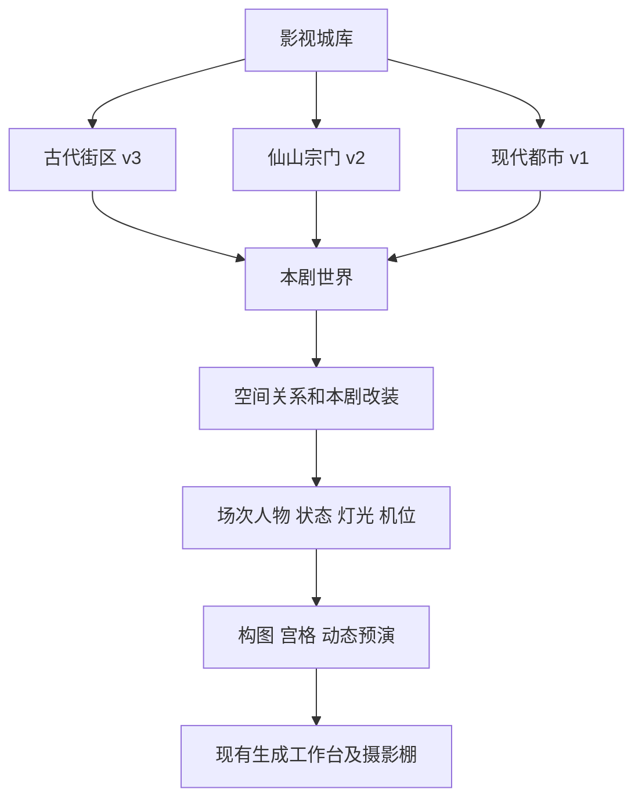

# 可复用三维影视城与高性能参考拍摄设计

更新：2026-10-27。本文顶部是当前建城与拍摄筹备规范；后半部保留历史技术设计。共享库、模型处理和参考拍摄已具备基础能力，**尚不等于自动完成专业片场筹备或动作验收**。现有社区是复用起点，不是所有剧本的合格答案；具体接口见 [虚拟制片说明](virtual-production.md)。

目标是建立人和 Codex 等外部 Agent 都能查找、观看、组合、改造和拍摄的影视城库。影视城具备可信的建筑结构、空间尺度和地理关系；按需加载可拍摄的模型，在桌面浏览器里流畅取景。普通制片流程保持独立，高级工具的产物继续进入已有生成工作台。

白模采用结构完整、材质简洁的模型。长方体、圆柱等仍可用于草拟和碰撞代理，但不能把只有体块的布局当作已经建成的影视城。性能优先于装饰细节，模型质量以取景和动作参考是否可信衡量。


## 可拍摄标准与筹备（当前规则）

以下规范借鉴真实制片部门职责与虚拟勘景实践，再按本系统的参考制作目的转化，**不是声称所有剧组采用相同组织、阶段名称或人数**。外部 Agent 可以兼任这些专业视角；不新增内部助手、部门账户、审批链或逐阶段用户确认。按[项目制作约定](agent-guide.md#首次一次问清后续按约定推进)控制粗审、返工与交付；以下专业标准供筹备与人工精审参考，不是Agent必须逐项反复执行的检查表。已有内容复用，仅明显大问题在约定范围内修正；不为静态参考精调完整动作。

### 先区分世界、片场与本场布置

真实制作会组合实景、实景改造、摄影棚搭景、外景基地与数字延伸；美术设计、拍摄需求、工期和资源共同决定怎么做。布景可以服务特定取景范围，不需要所有背景建筑都可居住。选址会评估创作适配、可达性、现场条件和后勤，美术部门把设计转成可建造图纸及实际布景。参考 [ScreenSkills 选址职责](https://www.screenskills.com/skills-checklists/scripted-film-and-tv/location-department/location-manager-skills/) 与 [APDG 部门分工](https://apdg.org.au/resources/screen-job-descriptions)。

在我们的系统中对应三个层次：

| 层次 | 保存什么 | 不应混入什么 |
| --- | --- | --- |
| 共享影视城/模型库 | 可复用地点、建筑与陈设的固定版本、用途和已知限制 | 某一集的群演、伤势、临时持物和剧情破坏 |
| 本剧世界 | 稳定地理、地点、路网、建筑、外围和对共享资源的本剧改造 | 为每个镜头重建并漂移的背景；其他作品的修改 |
| 本场拍摄方案 | 演员与群演、道具状态、临时布置、机位、时间和动作 | 覆盖原始世界去制造一次性剧情状态 |

本项目要求比单个摄影棚布景多一层：**已声明的整剧物理空间必须连贯，并具备正反向、窗外与远景覆盖**。允许未使用建筑只有外景，但要明确不能进入，不能用这个理由留下镜头可见的空城。图书馆目录中的两个影视城也不因此地理相邻；属于同一物理空间才连接，穿越或远地转场用叙事关系。

可移动墙、可拆屋顶等摄影需求要在布局阶段考虑。三维中若需要临时隐藏某个独立布景对象，可用场次状态并记录用途；不能删世界墙体或让摄影机穿墙来掩盖无法实现的路线。飞越/穿透等有意的数字镜头须明确表达意图，不能与人物或车辆的错误穿模混为一谈。

### 联合筹备：专业角色各自决定什么

| 专业视角 | 对真实片场的关键决定 | 外部 Agent 在本系统中的具体工作 |
| --- | --- | --- |
| 导演、编剧 | 本场发生什么、观众看见/知道什么、表演与叙事重点 | 从正文拆出动作与信息变化；决定必须看清的部件、出入口及切镜理由 |
| 制片主任、第一副导演 | 拍摄规模、日程、人员设备与可执行性 | 确定本次建设范围、复用资源、按依赖安排建模与试拍；记录未完成项，不擅自删剧情 |
| 美术指导、艺术指导 | 时代、社会环境、视觉语言、设计组织、工期与成本 | 形成统一世界规划；确认建筑与街区用途，不靠房屋数量和精细纹理冒充完成 |
| 外联/选景 | 场地创作适配、出入、许可、现场限制与后勤 | 查询并实际观看共享库；评估时代、尺寸、内外联系、改造量及资源许可 |
| 场景设计、制图、搭景 | 总图、平立剖、尺寸、开口、结构与施工细节 | 以米和明确标高建模；建可通行门窗、台阶、活动空间及拍摄需要的可拆组件 |
| 置景、陈设、绿化 | 家具、陈列、实用灯具、植被与生活痕迹 | 按实际生活/工作用途布置，不随机撒物；白模仍需可辨用途和真实空间关系 |
| 道具部门 | 演员操作的物件、功能、状态及复位 | 让开关、把手、工具、车轮等动作相关结构可操作；区分固定陈设和手持剧情道具 |
| 摄影指导、摄影、机械组 | 景别、镜头、视线、摄影机位置与运动实现 | 实拍主方向、反向、插入及运动路线，检查视野、遮挡和摄影机所需空间 |
| 灯光 | 光源方向、控制方式、灯位与连续性 | 先确定时段、窗/门/实用灯等光源依据；当前只验证基本光向，不冒称完整布光仿真 |
| 录音 | 对白可录性、噪声、环境声与拾音安排 | 标注叙事声源及对白/环境声需求；当前预演无声，不能据此验收声音 |
| 副导演、群演协调、演员 | 人员规模、走位、节奏、背景活动、入场与复位 | 明确本次负责人，把导演要求落实为各事件的人员位置/姿态/可见性；主体与背景共同布置，记录出入时刻、活动目的、禁入区和切镜承接，允许剧情合理的无人场 |
| 场记、服化道 | 故事日、动作、衣着伤势、道具与剪辑连续性 | 用已有资产/场次状态维护同一事实；检查切点和跨场变化，禁止每镜复位 |
| 动作、特效、视效/虚拟美术、技术美术 | 特殊动作、实拍与数字部分、可视化、性能和资源交付 | 提前标出精细接触、破坏或动态的技术缺口；管理几何、LOD和帧时间，不让缺能力被漂亮静帧掩盖 |

职责依据包括 [BFDG 美术部门](https://britishfilmdesigners.com/resources/job-roles-explained/)、[ScreenSkills 摄影指导](https://www.screenskills.com/skills-checklists/scripted-film-and-tv/camera-department/director-of-photography-skills/)、[录音](https://www.screenskills.com/skills-checklists/scripted-film-and-tv/production-sound-department/production-sound-mixer-skills/)、[副导演与群演协调](https://www.screenskills.com/job-profiles/browse/film-and-tv-drama/production-management/assistant-director)、[场记](https://www.screenskills.com/job-profiles/browse/film-and-tv-drama/technical/script-supervisor-film-and-tv-drama/)。上表右栏是我们对这些职责的产品转化。真实搭景还涉及结构、电气、消防、吊挂、特技安全等专业责任，参见 [搭景负责人职责](https://www.screenskills.com/job-profiles/browse/film-and-tv-drama/craft/construction-manager/)；我们的数字参考不能作为实物施工或安全批准。

### 从剧本到可拍片场的执行顺序

这是可迭代的准备顺序，**机位与动作必须在精建之前试验**，不能等房子和道具做完才发现拍不了。虚拟勘景用于在建设中测量与调整环境；预演用于表达镜头和动作，技术预演用于验证实现条件。参考 [Epic 虚拟勘景](https://dev.epicgames.com/documentation/en-us/unreal-engine/virtual-scouting-in-unreal-engine) 与 [虚拟制片概念](https://www.unrealengine.com/explainers/virtual-production/what-is-virtual-production?lang=en-gb)。采用这些方法不要求改用 Unreal。

| 工作 | 必须回答的问题及实际产物 | 发现问题时修改哪里 |
| --- | --- | --- |
| 1. 剧本拆解 | 按全剧已知场次列地点、故事日/时段、人物及背景生活、动作、手持物、特效、进入离开关系；提取必须看清/操作的物件 | 剧本不明处注明推定与依据；不把额外生活背景写成新剧情 |
| 2. 勘景与建设范围 | 选复用、改造或新建；确认地理与时代、实际尺寸、内外景能力、外围/地平线、资源许可及性能基线 | 保留合适旧世界，补缺口；不要从标题臆测共享模型可用 |
| 3. 总图与技术勘景 | 地形路网、地点关系、标高、出入口；用粗模提前试人物路线、持物范围、摄影机主反方向、运动与光源方向 | 先改布局/开口/位置；粗模只用于验证方案，不能交作成片参考 |
| 4. 结构与功能细建 | 按可拍景别建几何；主拍区实际门窗、楼梯、操作面和剧情部件，周边与远景仍覆盖；尺寸来自功能和尺度依据 | 在作品目录建模/调整，正式导入；不改系统源码或用装饰掩盖功能错误 |
| 5. 置景与排演 | 工作/生活动线、主角与群演、车辆、道具操作、事件初末状态；从接近到离开完整排演 | 修改本场摆放、状态、挂点和时间；固定空间不够用再扩建世界 |
| 6. 实际机位与接触验收 | 鸟瞰确认关系，实际镜头确认可拍；按实际用途粗看代表机位和明显接触问题，记录具体版本与问题；不默认遍历所有视角或精修未使用动作 | 明显大问题在约定范围内修后重拍；达到上限交作者，不用改镜头藏问题 |
| 7. 性能与制作交接 | 用实际取景路线测加载/帧时间/LOD跳变/资源释放；按用途导出静帧、宫格或白模视频，并关联准确来源 | 优化重复几何和细节级别，保留关键轮廓/接触与环境覆盖；只重做受影响参考 |

真实制作的搭建、置景、排练、灯光测试和技术检查可能交错进行，上表不是不可回退的瀑布流程。这里不要求给每个镜头做全部种类的参考，也不要求批准“整个世界”才可拍已建且验收过的区域。尚未完成的区域必须在世界资料中明示；本次取景能看到或动作会经过的区域不能以“后面再补”放行。

### 现有数据如何承接，避免多份真相

筹备结论写入现有对象，正式接口字段不新增、不臆造。不要把所有专业角色变成独立文档或服务。

| 内容 | 唯一业务归属 |
| --- | --- |
| 剧情、角色/道具外观、故事时段与事实 | 正式剧本/场次、资产档案；三维用 `sourceSceneIds`、`assetId` 引用，不能再复制一套人物设定 |
| 整剧地理与建造范围 | `worldBrief` 的 `geography/circulation/services/skyline`；`description` 说明建设意图，`gaps` 只列实际未完成/未验证项 |
| 地点能做什么、内外景限制、标高依据 | `locations.description/usage/detailTier/spaceId`；精确尺寸以实际模型和坐标为准。描述可用“用途；动作；内外关系；限用”简短句式，不变成第二份几何数据 |
| 静态结构与可复用版本 | `models/instances/objects`，资源许可与文件信息沿用模型库。动态门扇等需独立对象；当前不能假设一个合并GLB内部件可独立驱动 |
| 演员、群演、移动道具和剧情变化 | 场次 `objects`、`performanceRole/activity`、`frames.states`，关键动作与承接写 `frames.note`；帧以正式 `shotId` 和叙事时间组织 |
| 勘景、实际取景与光线 | 世界 `viewpoints/routes` 留检查视角；场次 `frames.camera` 与 `plan.light` 承载已有参数。超出现有灯光/镜头参数的意图写备注，不能声称已执行 |
| 检查结果、失败与修改依据 | 对应 `viewpoints.note/frames.note` 放简短结论和证据定位；完整测量/图片/视频保存在作品目录，作品交接记录世界/场次版本、适用范围、失败、下一步 |

`gaps` 不是成功清单，文字“可拍摄”不是审核状态。保存、候选应用、下游参考仍走既有版本检查和采用流程。改变世界/镜头/动作后，只重新核验受影响范围，但不能继续把旧版本证据算作新结果。

### 质量结论必须限定用途

- **布局草稿**只验证尺度、地理和可达关系，允许体块；不得标为能拍细节的模型。
- **指定机位可用**要求从实际景别看清功能与结构：门窗是真开口，室内外方向吻合；工作台容纳操作；提灯开关、电池仓等剧情部件有可信位置和尺度。白模不必有纹理，但不能以低面数为由把关键工具做成无意义方块。
- **动作排演通过**还要看接近、接触、操作、离开的完整过程、遮挡和切点；静帧通过不表示动态通过。当前有双段手脚IK和网格检查，仍没有手指、全身物理或导航；无法表达的精细动作写明缺口，不宣称已验证。

结论至少说明世界/模型与场次版本、适用机位及景别、实看证据、未验证动作。不得把“文件可加载”“物件数量足够”“以前FPS达标”当作当前镜头的质量证明，也不增加全局“整城合格”布尔门禁。

建模可复用有许可的资源，或在独立作品目录用 Blender/Three.js 建模并导入 GLB；不局限于 `box/cylinder` 和内置样板。主拍区保留功能部件，中景保持用途与比例，远景降低细节但保持环境覆盖。实例化用于真正重复的组件，不把同一栋楼复制成整座社区。记录当前版本、设备、分辨率、移动路线的帧时间P95、加载量与资源占用；以已验证性能基线控制预算，不能只测静止视角或提高面数。

### 正反案例怎样使用

[可运行案例与同机位对照](../examples/virtual-production/README.md)提供局部修理铺、街边背景调度的真实三维资源、原生计划、截图及重拍工具。它展示“体块草稿与指定机位可用”的差别，**是局部布景教学，不是完整社区样板**。全剧仍先规划地形、路网、街坊、设施及远景；需完整环境时复用/扩建共享库。案例不可直接替代具体剧本，不复制案例ID到已有项目。

| 检查对象 | 不合格例 | 指定用途合格条件 |
| --- | --- | --- |
| 街道 | 只加房屋数量、重复立面、窗口外空白 | 入口面向实际步道，街角有去向，主拍区与外围连续，生活活动符合时段 |
| 修理铺 | 一块桌板加几个方块，只有名称叫工具 | 货架/操作面/通道有分工，近景工具可辨，手和道具不埋入台面 |
| 交通工具 | 特写只有两个圆和一条杆 | 近景车架、轮胎/轮辐、车把、坐垫和脚踏关系可信；远景可简化 |
| 人物动作 | 悬空接触、穿模、跨切点复位 | 所需动作阶段和接触/持物状态成立，背景活动不会无故瞬移 |
| 参考转绘 | 白模背拍变正面，构图图被当灰色风格 | 指定空间/机位保持，资产决定身份，美术参考决定材质；冲突先修来源 |

例如“骑车到店门口，停好车，取灯入店，修好后离开”：先验证街道/路沿/停车位与入口相连、车把能通过需要经过的开口、人物能放车与持灯转身、台面容纳灯和双手操作、主反机位都拍得到动作，最后才补表面细节。群演可以经过街边，但不能挡住关键交接或在反打中换位置。**只有漂亮门面、自行车和工作台模型仍不够**；若现有人偶做不了取灯动作，应记录动作缺口，不能把移动模型文件当成动作完成。此例是筹备方法，不是为所有剧本预设相同剧情。

### 穿模与接触：必须通过的质量底线

不合理穿模一经发现，本场相关参考就是不合格：修正前不采用、不进入下游生成、不交付。草稿和失败证据可以保存，不能把保存成功或“白模只是参考”作为放行理由。不新增审批表，继续使用已有检查结果、缺口和参考来源记录。

- 接地检查用**变换后的实际几何与实际支撑面**。模型以底部中心归一化不代表 `position.y=0` 就正确；计入地点origin、旋转/缩放、轮胎厚度、人行道/台阶顶面和LOD量化。分别查两轮、双脚、桌凳支点；两侧高度不同先调整停放/姿态，禁止只抬到最高点让另一侧悬空。
- 动态用途关注接近、接触、操作与离开的明显穿模，不能用端点正常推断全程正常；自动采样检查可复用，不要求Agent逐帧人工复查。静态参考按实际取景粗审，不强制完成未使用的动态过程。明显问题在约定范围内修内容，未解决则标明交作者，不伪称合格。
- 用包围盒做快速筛查，疑似接触以网格/射线和近距离低机位画面复核；包围盒相交不等于实体穿模（例如门洞），没有碰撞报警也不等于通过。数值容差仅处理计算精度，不容忍画面可见的埋地、悬空或穿透。
- 墙体装配、地基/植物埋设等真实结构关系允许；人物穿墙、轮胎埋地、道具穿手/台面不属于这种例外。失败记录对象ID、世界/场次版本、镜头和时间，再修正并重拍受影响参考；不覆盖原证据，不冒称整城都已检查。

当前已提供基于实际网格、支撑射线和自适应采样的接触检查，入口与字段见[动作控制与接触检查](virtual-production.md#动作控制与接触检查)。它不是刚体求解或自动导航；数值结果与Agent粗审分开记录，人工负责最终画面与完整动作精审；不额外追加强制精审轮次。

**渲染v2修正（2026-10-27）**：旧版站姿悬空11厘米、蹲姿埋地约3.2厘米和跪坐共用构型已修正。统一骨架以实际脚底为基准，默认站立高度1.8米；走跑有膝关节和距离驱动的支撑步态，蹲跪起身平滑过渡，坐姿支持实际座面高度。手部目标、肘向、握持方向和逐帧挂点用于安排接近/拿起/放下。根位置默认保留编排高度，跟随支撑面须显式启用；不能假设任意姿态、旋转和路径已自动合理。旧参考按渲染版本失效，媒体保留；当前验收证据与范围见动作验收记录（原路径 `../artifacts/previs-contact-20261027/README.md`，已于2026-11-09按用户要求清理）。

制作 Agent 可以改项目模型、摆放、挂点和关键帧；遇到渲染器不能正确表达的必要动作，记录为系统缺口交维护处理，不自行改源码，也不能降低该动作的验收要求。静态构图在独立核验接地后可限定用途使用；这不意味着动态参考合格。

### 背景人物与环境活动

副导演/群演协调承接导演的场次需求，直接交付实际布置：本场人员、当前事件的在场人员、镜头内可见人员分别判断。群演规模须有剧本依据；没有精确人数时说明当前布局的估计，不随机填满。摄影用相关代表机位核对遮挡、主次和规模，场记核对跨场身份/位置/姿态，统筹负责把发现的问题交给具体执行者；不增审批或自动返工。只做静态试景也可摆人物代理，不因视频暂停而遗漏人物，不要求为静态用途新增叙事镜头或编造时长。

白模采用稳定识别色并配合名称/活动说明：主要角色各有可辨颜色，剧情群演建议橙色，环境人群建议青绿色，建筑保持低饱和；已有项目色表可沿用。颜色是制作身份标记，不是服装、阵营或成片美术。近处保持可读人体结构，远处可减细节但保留人数规模和合理姿态。剧情群演与环境人群均可用既有 background 身份，在 activity 中说明具体职责，不增人物档案或另一套人群模型。

空场资产图保持干净；场次是否有人由时代、地点、时段和剧情决定。剧本只列两名角色不代表城市只能有两个人；补环境活动不得增加新的剧情人物、事件或遮挡叙事。停业、深夜或有意孤寂可明确安排无人，不按固定人数填场。

复用现有 `PrevisPlan.objects` 和 `frames.states`：背景人物用稳定ID的 `kind:actor`，`performanceRole:background` 与 `activity` 说明用途；不需要伪造主角档案或全套八表情资产。`assetId` 可选，有明确外观需求才绑定真实资产。主角默认沿用旧对象。路线通过镜内关键帧的位置/朝向/姿态/visible表示，不增加另一份人群时间线；切镜后显式接上前镜状态。场次人物不能塞进共享空城原件。

安排前、中、后景的合理活动和停留点，如收摊、等待、步行、骑行。记清起点、终点、出入时间、身份/服装延续及镜头禁入区域；车辆可用现有模型位置关键帧。当前有网格检查但没有自动导航/避障，逐镜回看穿墙、相撞、滑步、抢戏和突然出现；不能承诺自动群演仿真。少量近处人物用可读结构，远处代理降低复杂度；不要将骨骼人物未经验证直接按静态模型实例化。

## 2026-10-27 专业片场能力审查

结论：架构能承接可复用世界和由人/外部 Agent 完成的虚拟勘景，**还不能把现有建城任务或样板称为专业片场自动交付系统**。以下区分已实现的工具、当前需人工/Agent负责的工作及真正缺失的能力；文档补齐不等于引擎已经补齐。

| 检查面 | 源码中的实际情况 | 当前限制及处理方向 |
| --- | --- | --- |
| 整剧筹备 | `worldBuild.ts` 读取剧本、资产摘要和现有世界，合同已要求路网/设施/远景 | 未自动产生联合技术勘景或动作可行性结论；Agent须先按上文组织筹备，把相关结论写入现有对象 |
| 世界复用与结构 | `PrevisWorldPlan` 支持地点、物理/叙事连接、模型、版本实例、固定视角及路线 | `detailTier:shootable` 是自述，不验证门窗净空、操作空间或反打；GLB可加载也不证明用途成立 |
| 候选与验收 | 建城任务可保存候选、实际预览并按来源/版本应用 | `ready/apply` 不能自动判定无穿模或可拍摄；现有checks报告保留对象/部位/镜头/时间/来源，数值通过仍要实际图像与播放证据 |
| 摄影与灯光 | `PrevisCamera` 有位置/目标/焦距；渲染器固定36mm filmGauge；场次仅主方向光位置/强度，另有固定环境光 | 可验证构图和基本光向；没有可配置传感器、光圈/景深、镜头畸变或多灯方案。不能把默认光下的图当成夜景/复杂布光已验收 |
| 演员、群演与道具 | 有背景身份、活动说明、支撑步态、双段手脚、手部目标/肘向、座高与逐帧拿放 | 没有手指、完整全身IK、物理和导航。自定义骨骼动画不能依靠静态GLB优化通道自动获得 |
| 动态与连续性 | 镜内插值、姿态过渡、连续步态和跨挂点坐标保护，检查包含中途与拿放跳变 | 超过240Hz检查需求会明确不完整；复杂转身、精细接触和节奏仍须编排与观看，备注不会自动成为动作 |
| 性能与证据 | 已有LOD、实例化、资源缓存/释放、路径预载及PNG/MP4来源 | 质量与性能都需当前版本真实路线测试；历史小样数据不能覆盖任意新场地，优化不能破坏接触几何和关键轮廓 |

源码依据：[空间合同](../packages/domain/src/previs.ts)、[建造任务](../src/server/spatial/worldBuild.ts)、[建造指令](../src/server/spatial/worldBuildContract.ts)、[基础渲染](../src/components/spatial/previsRenderer.ts)、[空间运行时](../src/components/spatial/spatialRuntime.ts)。本次为代码/合同与人偶几何审查，没有重新验收所有已有作品画面。

本轮已将接地基准、双段姿态/目标、实际网格检查与拿放控制接入现有工具。后续按作品需要扩展完整骨骼表演、复杂地形步态和镜头/灯光配置，不能把它们视为当前能力。生产内容出错由制作Agent修内容，通用实现出错由维护任务修系统；不另建资产库、时间线或审批流程。

## 本轮落地范围与验收入口

已实现：人工 AI 建城/扩建按钮与外部 Agent 共用任务、候选修改/预览/版本化应用；共享固定版本库、整城/部分地点复用与组合、本剧改装、静态GLB保留原件及worker优化、LOD/内容去重/顶点色合批、空间格实例化、增量远景合并、资源释放和性能诊断；地点父子层级、物理连接/叙事转场、固定取景点与巡视路线；简化关节人物、手/腰挂点与旋转枢轴；路径预载固定LOD、后台PNG及可暂停续拍的整剧MP4。

完整原创样板“清水·河岸社区”：11个功能分区、402件布景，医院/学校/住宅/商铺/公园/道路/河岸/外围环境共同组织；12个实际机位与34秒连续巡视已出图/出视频。全部LOD运行模型合计约4.17MiB，原始模型约14.2MiB。截图、动态视频和性能证据位于 `artifacts/spatial-studio-2026-10-26/`，不是用阵列截图替代城市验收。

1080p、DPR1、Apple M4/Chrome156上实测90秒路线，预热后帧间隔中位16.7ms、P95 19.9ms、P99 27.2ms；20轮进出后模型引用/几何释放为0。该性能样本包含405件布景，之后只移除挡门诊通行的3辆车。不能推广成所有设备、任意模型均达标。

下文的精细蒙皮动画、完整全身IK、刚体碰撞求解/导航、复杂室内遮挡、磁盘LRU自动清理等仍是扩展设计，不是本轮提供的能力，也不作为普通制作的隐藏依赖。当前自由取景无碰撞，人工/Agent应检查路线；重要内景和特写可导入专门结构模型。世界建造质量需要具体剧本与实景检查，本系统不声称一键自动生成所有题材的完整世界。


## 本轮纠偏：完整世界不是若干建筑的陈列

用户实看后指出，三栋客栈或实验楼不能称为街区、社区或影视城。本轮实现确实低估了世界建造要求：此前重点验收门窗、楼梯、模型复用与性能，却没有把完整空间组织及远景覆盖作为影视城交付的前提。**原两套样板降级为建筑组件/渲染测试，不得用其性能与截图宣称完整世界已经实现或建成。**

### 建造的对象与尺度

目标是能承载整部剧、真实可理解的连续环境。空间应包含地形与水系等基底、道路/巷道/步行网络、地块与建筑群、功能设施、公共空间、周边背景和地平线。现代作品可包括住宅社区、商铺、医院、学校、办公区、公园及停车/后勤；古代作品按时代与剧本组织城街、民居、集市、客栈、衙署、医馆、城门及城外环境。**这些是世界构成的例子，不是所有作品必须填齐的固定清单。** 不给荒村或修仙宗门机械塞入现代学校医院。

世界并不要求一开始精建整颗星球，但已声明的空间范围应完整：道路有来处和去处，街角/院墙有背后，建筑有合理地块和入口，窗外、高机位与反向取景都有对应环境。远景可以简化几何和材质，不能直接消失，也不能用天空或雾掩盖未建成的街区。

采用三层建造投入：

1. **主体拍摄区**：依据剧本完整搭建可活动结构、内外联系及需要的陈设。能进入、能转身、能从多个方向拍摄；特写另选足够精细的组件。
2. **周边环境**：完整的街道、街坊、院落、设施与相邻建筑关系。未拍到的室内可不建，但须注明仅外景；不能把所有楼都做成主角建筑的重复复制。
3. **远景与地平线**：按地理与时代建立延续的天际线、山体、水岸、城墙或远郊；用低细节实体/HLOD保持空间覆盖。远处资源降级不等于删除环境。

这与行业城市语义模型把建筑、交通、地形、植被、水体和城市设施共同组织的方式一致。参考 [OGC CityGML 概念模型](https://docs.ogc.org/is/20-010/20-010.html)。我们借鉴空间组织，不在本轮强加 GIS/CityGML 技术栈。远景驻留参考 [Epic HLOD 文档](https://dev.epicgames.com/documentation/unreal-engine/world-partition---hierarchical-level-of-detail-in-unreal-engine)，不切换引擎。

### 外部 Agent 接手时的建造顺序

使用本文顶部的[统一筹备顺序](#从剧本到可拍片场的执行顺序)，接口操作集中在[外部 Agent 执行手册](virtual-production.md#外部-agent-不调用模型的执行顺序)。世界规划与实际机位/动作验证共同推进，不再另列一套“先堆完建筑再拍摄”的步骤。

### 修正系统合同及界面

- 目录明确区分“建筑组件 / 布局草稿”“街区”“整片世界 / 影视城”，规模自述不自动变成通过状态。
- `worldBrief` 持久保存世界意图、地理、交通、功能配套、远景与未完成项；用于下一会话接手，不藏在聊天里。
- 地点的 `spaceId` 表示同一实际物理空间，`detailTier` 表示主体/周边/远景，`usage` 表示用途。旧版没有这些信息时保留旧语义，不推测旧地点的相邻关系。
- 同一 `spaceId` 的环境默认参与场次取景与来源计算；额外手动选择用于其他明确背景。不能默认只画一个地点，使其周围空掉。
- 性能降级保留远景几何；后续 HLOD 合并须保留轮廓与地标，并在相关改装后失效。不能简单以距离阈值清空远处建筑。
- 完整街区交付必须有真实路线及多方向画面证据。仅在表单填写“已完整”或在模型上写“医院/学校”不构成验收。

原建筑组件样板没有道路、街坊、配套或远景，其用途仍仅限组件预览与技术测试。本轮完整社区样板的实际证据见顶部；其它年代仍须逐作建造和观看验收，不得把“加了更多同款房子”称为完整世界。

## 一 核心决策

1. 建立工作区共享影视城目录。一部剧可以引用多座影视城的指定版本，也可以只引用某个街区、建筑或房间。
2. 本剧保存组合关系及改装；基础资源共享，项目修改不覆盖影视城原版或其他剧。
3. 将物理相连的空间、不同世界之间的叙事转场、复用同一建筑组件分开表达。穿越是叙事关系，不是必须单独建设的建筑风格。
4. 以真实比例、建筑轮廓、门窗开口、可用室内、关键道具和可理解的动作空间为模型标准。贴图可少用或不用，关键形状不能省略。
5. 先解决持久场景、资源共享和逐帧更新，再引入详细模型；随后落实分区加载、LOD、HLOD、实例化、材质合批和缓存预算。
6. 编辑取景默认争取稳定60fps；最终参考视频用确定时间步离线渲染，不依赖实时录屏。性能目标必须在规定机器、画幅和真实样板场景上验证。
7. 人和外部 Agent 共用目录、资料、渲染器、版本及保存规则。Agent 既能读结构化信息，也能取得实际预览，不能仅凭名称和 JSON 判断景已经可用。
8. 复用当前 Three.js、虚拟制片、资产、生成和摄影棚基础，不另建内部 AI 助手、并行资产库或另一条成片流水线。

## 二 实施前基线与缺口（历史问题定位）

以下是开始本轮改造前的基线，不能当作当前实现结论。现在已接通的能力和未完成项见 `doc/virtual-production.md` 的“共享影视城、完整空间与取景”及交接顶部。该历史检查时4344服务未能连接，没有把历史截图当作实时页面验收。

| 当前能力 | 保留方式 | 必须补齐 |
| --- | --- | --- |
| 项目级 world 和场次 plan 分开保存 | 保留项目世界及场次排演边界 | 项目世界可引用共享库中的多座影视城 |
| 地点有名称、说明、origin、场次关联 | 迁移为地点资料及稳定映射 | 建筑层级、空间连接、地图标注与可视化选景 |
| 世界总览可显示多个地点 | 保留统一总览 | 目前位置主要用于排列，不能等同真实地理关系 |
| 拍摄只加载一个 location | 保留旧方案兼容 | 支持同一镜头跨门、跨房间、跨相邻分区 |
| box、cylinder、stairs、actor | 保留为草拟和代理 | GLB模型、结构化建筑组件、骨骼人物、可动门及道具挂点 |
| PNG、宫格、分镜到整剧无声MP4 | 继续使用同一导出服务 | 持久运行时、预加载、后台任务和稳定帧步进 |
| JSON导入导出 | 保留便携交换 | 有预览、版本与依赖清单的影视城资源包 |
| 生成参考有来源追踪 | 继续使用正式候选及采用流程 | 来源覆盖实际加载的跨区模型版本、改装和拍摄快照 |

当前性能风险可直接定位：

- `src/components/spatial/previsRenderer.ts` 的 `createPrevisVideoRenderer.frame()` 每帧创建并销毁整套场景、几何和材质；增加精细模型前必须改为常驻资源与状态更新。
- `src/components/spatial/PrevisViewport.tsx` 在 plan、frame、time 等属性变化时重建场景，播放不应反复经过完整 React 场景重建。
- 几何和材质目前按物体创建；还没有模型资源池、分区实例批次、LOD资源生命周期及预算管理。
- 当前整集导出在页面循环中执行。已上传帧可续传，但页面重载会中断渲染，不能成为长期后台拍摄的唯一方式。

模型包变小并不会自动修复上述运行时问题。

## 三 人理解的四个概念

| 概念 | 用户能做什么 | 数据归属 |
| --- | --- | --- |
| 影视城库 | 浏览古城、民国街区、现代园区等；查看实景预览和可拍区域 | 工作区共享，可有多座独立影视城 |
| 本剧世界 | 选用完整影视城或局部区域，建立本剧空间与转场关系，改装和扩建 | 当前作品 |
| 拍摄地点 | 在地图上定位街道、院落、楼层或房间，查看入口与关联场次 | 世界中的稳定地点 |
| 场次拍摄 | 安排人物、剧情状态、灯光和机位，导出构图与动态参考 | 正式场次及镜头 |

用户不需要学习数据库表或资源哈希。页面统一使用上述名称；内部可将项目世界作为多个共享场地的实例组合。

## 四 多影视城组合和空间关系

### 共享影视城与本剧世界

一个影视城发布版本包含空间目录、固定地形与建筑、可拍室内、连接点、资源依赖、预览及性能报告。稳定编号不依赖名称；改名不会断开镜头引用。

本剧世界引用不可变的发布版本。例如：古城街区 v3、山门区域 v2、现代办公楼 v1。可单独放置同一建筑的多个实例，每个实例有独立身份、位置和项目改装，共享底层模型文件。

层次关系：



### 三种组合必须区分

| 组合 | 例子 | 系统处理 |
| --- | --- | --- |
| 实际空间拼接 | 古街尽头连接城门，城门外连接山道 | 门洞/道路连接点对齐，校验方向、地面高度、宽度及遮挡，建立可连续拍摄区域 |
| 剧中世界切换 | 现代上海穿越到修仙宗门 | 不同空间根，保存转场关系；分别加载，不凭总览位置推断相邻 |
| 组件借用 | 民国剧使用一套古宅，现代剧改造成博物馆 | 引用同一模型版本，增加本剧陈设与改装，不修改原件 |

时代、建筑风格、地点用途和题材适用性分别作为可扩展标签。古代、民国、现代可描述时代；中式院落、石库门可描述结构风格；穿越描述作品题材。不能把所有标签写成互斥的五个硬编码类型。

### 整体世界和分区存储

一个物理空间内使用统一米制、Y向上、统一朝向约定。影视城或组件具有局部坐标，通过实例变换进入本剧空间；道路、楼梯、门和窗的连接点随变换同步。

默认只对组件做平移、旋转及合理的整体等比缩放。建筑实际尺寸和连接点必须随缩放检查；镜像生成单独处理过法线和连接语义的变体，不直接把负缩放矩阵塞进实例批次。组合引用检查循环依赖，选用局部区域时携带它实际依赖的模型、接口和背景，避免漏掉门框或窗外景。

物理连续区域可按街段、院落、建筑和楼层分区存储。分区是加载策略，不能给观众造成断路或突然消失的建筑。跨区镜头同时加载所需区域。异界等不相连空间不通过巨大的坐标距离硬塞进同一场景；世界总览用标注或关系视图表达。

建筑由外壳、室内单元、门窗、屋顶等组织。室内外尺度和窗外视线需要一致。只有外壳的建筑明确标为“仅外景”；没有室内的房子不能因门口可见就被Agent选为室内拍摄地点。

### 本剧改装和版本

共享版本发布后不可原地改写。本剧保存添加物体、隐藏构件、替换材质、移动实例和局部结构替换等覆盖。结构变更形成新的组件版本；不是把原GLB拆成大量临时顶点补丁。

改装可另存为共享新版本，但不自动反向发布。其他作品继续使用原版本；更新需显示几何、尺寸、连接点及关联镜头差异。用户已允许正常制作编辑，不增加新的费用或执行授权表单。

顺序为：基础影视城版本 → 本剧改装 → 明确使用的场次状态 → 镜头关键帧。场次间是否继承损毁、持物和天气由剧本指定，不按场号自动继承，也不默认复原。

## 五 白模资产质量标准

### 结构完成的模型

至少保证以下内容真实可读：建筑高度、墙厚和楼层；门窗实际开口；楼梯与平台；屋顶、檐口、立柱等重要轮廓；演员可站立和行走的空间；拍摄有关的家具与道具接触面。

中近景不能用一块盒子代表客栈，也不能把门窗画在封闭墙面上。圆柱仅能代表本来就是圆柱的结构或临时代理。玻璃可用简化透明或开口表达，避免层层透明面带来高开销。

以下内容按镜头需要投入：细小倒角、瓦片起伏、装饰雕刻、螺丝及背面不可见结构。对轮廓和遮挡没有贡献的细节可以省略或用低成本材质表达。默认使用有限灰阶、柔和明暗及必要语义色，避免纯白无层次导致模型不可读。

### 精度按拍摄用途分配

| 用途 | 需要保留 | 可以简化 |
| --- | --- | --- |
| 城市总览 | 街道走向、地形、建筑高度与地标 | 窗框、室内、细小陈设 |
| 街道中景 | 檐口、门窗、台阶、骑楼、柱廊 | 瓦片逐片建模、装饰微细节 |
| 室内走位 | 房间比例、门洞、家具、承重和接触面 | 背后不入镜的装饰 |
| 道具特写 | 剧情使用的轮廓、开关、握持点、断裂或开合结构 | 与剧情无关的内部机械 |
| 人物排演 | 合理人体比例、关节运动、接触与持物位置 | 高精面部、毛发、布料模拟 |

把模型的“适用景别”和已检查视角写入资料。Agent拍特写时应能发现普通版本细节不足，选择局部精细版本，而不是把整座城市升到最高精度。

### 模型来源和处理

优先利用合适的模块化资产、已有可授权模型，以及人工或外部Agent通过Blender等工具制作的结构化模型。Three.js负责运行时取景；浏览器不承担完整DCC建模软件的工作。

AI生成模型、扫描模型和CAD导出都作为输入候选，需要检查比例、背面、内外连接、法线、拓扑和面数。没有可靠室内结构时明确缺项。基础体块仍可先快速规划，但发布资料保留“布局草稿/可拍模型”状态差异。

处理流程为：导入原件 → 单位及坐标归一 → 几何和资料检查 → 分区/分件 → 按误差生成LOD及远景代理 → 网格与材质去重 → 压缩 → 生成真实预览 → 浏览器与固定镜头检查 → 发布版本。原文件保留，优化失败不覆盖原件。glTF Transform已提供检查、去重、实例化、简化、量化和压缩能力；其官方说明也提醒通用优化默认值不一定适合每个场景，所以本系统应按建筑、人物和道具分别配置。[glTF Transform工具](https://gltf-transform.dev/cli)

首版运行包以glTF/GLB为主。OBJ/FBX/Blend等通过转换任务生成运行包，不在每次打开页面时重新转换。白模默认不强求贴图；少量必要贴图使用受支持的压缩格式和mipmap。当前仓库Three.js版本为0.183.2，已有GLTFLoader可用，但业务加载尚需接入；扩展组合必须用锁定版本实测。[Three.js GLTFLoader](https://threejs.org/docs/pages/GLTFLoader.html)

## 六 业界实践如何落到本系统

完整世界不等于一次全部载入内存。Unreal的World Partition将一个持续世界组织成可加载的网格，并由流送源决定区域加载；本系统借鉴这种管理方式，以摄影机和即将拍摄的路径作为加载依据，不引入Unreal运行时。[World Partition官方说明](https://dev.epicgames.com/documentation/en-us/unreal-engine/world-partition-in-unreal-engine)

远处街区用合并简化代理呈现，近处再换成独立可编辑建筑。此做法借鉴HLOD：对未加载的远区保留轮廓，同时减少绘制次数；不能把远景代理当作近景或室内拍摄模型。[HLOD官方说明](https://dev.epicgames.com/documentation/unreal-engine/world-partition---hierarchical-level-of-detail-in-unreal-engine)

Khronos的实时资产指南同时强调必要几何、细分场景利于裁剪、网格复用以及文件和显存优化。因而本方案分别控制下载体积、CPU/GPU驻留、绘制成本和可见质量，不能只用一个总面数判断性能。[Khronos实时资产指南](https://github.com/KhronosGroup/3DC-Asset-Creation/blob/main/asset-creation-guidelines/RealtimeAssetCreationGuidelines.md?plain=1)

### LOD和HLOD

- 每个中大型模型准备近景、中景、远景版本。LOD0代表允许拍摄距离内的完整模型，不代表原始无限高模。
- 优先按屏幕投影大小/几何误差决定LOD，考虑焦距、画幅及输出分辨率。基础Three.js LOD提供距离和迟滞机制；本系统需要在其上实现摄影机感知的选择，不宣称引擎原生已有完整流送方案。[Three.js LOD](https://threejs.org/docs/pages/LOD.html)
- 同一建筑在不同LOD下保持尺寸、原点、门洞和关键接触点。相邻LOD在连接边界保护顶点，防止缝隙；量化误差也需检查，不能只追求最高压缩比。[KHR_mesh_quantization说明](https://github.com/KhronosGroup/glTF/blob/main/extensions/2.0/Khronos/KHR_mesh_quantization/README.md)
- LOD切换有迟滞。首版避免默认双层透明渐变造成额外绘制和闪烁；普通浏览可在低显著区域切换，记录拍摄时采用固定规则。
- HLOD按街区或建筑群生成，保留地平线与标志轮廓。与近区接替时不同时完整绘制两份，也不能让建筑先消失再出现。
- 局部改装会使相应区域的HLOD过期。重建前回退到有效细节或清楚标注的草稿预览，禁止继续显示旧外观并输出参考。

LOD构建同时设置目标比例和允许误差，不要求每个模型机械减到50%、25%、10%。有损简化达到误差上限时应停止；保护硬边、材质边界、门窗、铰链和挂点。[glTF Transform简化算法](https://gltf-transform.dev/modules/functions/functions/simplify)

运行清单显式记录各LOD文件、几何误差和共享锚点，不能假定普通GLTFLoader会自动完成多文件LOD流送。透视相机可用世界误差投影到像素的估计辅助选级，最终以实际画面校验；正交总览使用另一套投影比例，不能照搬距离阈值。

LOD隐藏高精对象不等于已经释放它的内存。需要近景时才载入高精资源，远离后交资源池按预算回收。实例化也不意味着可见实例的顶点工作归零，仍需要LOD与分区裁剪共同限制总绘制量。

### 复用加载和GPU实例化是两层

文件相同：以内容哈希和版本作为缓存键，同一GLB只取一次、解码一次，几何及材质在当前渲染上下文共享。放置100把相同椅子不能存100份模型，也不能创建100套相同Geometry与Material。

绘制相同：同一几何、LOD、材质/着色变体、渲染层及兼容阴影设置的对象组成GPU实例批次。每个实例保存自己的变换和语义编号。Three.js的InstancedMesh适合相同几何与材质的多次放置；不同几何且材质兼容时，可评估BatchedMesh。[InstancedMesh](https://threejs.org/docs/pages/InstancedMesh.html)、[BatchedMesh](https://threejs.org/docs/pages/BatchedMesh.html)

批次按空间分区与LOD再划分，避免整座城只有一个巨大包围盒，造成可见一把椅子就绘制全部实例。分组边界和包围体在实例移动后更新；修改一扇门不重建整个城市。

逻辑对象编号与GPU instance索引分离。选中、拖动、绑定镜头和保存操作仍指向稳定对象；删除或重排GPU实例不会错绑。独立改材质的物体转入兼容批次或暂时独立显示，不直接修改所有实例的共享材质。

骨骼角色不直接套普通InstancedMesh。主角和少量重要人物使用标准骨骼模型与动画，远处群演才考虑受限动画代理。实例化收益取决于CPU/GPU瓶颈和分组开销，不承诺启用后必然提升帧率。[Unity GPU实例化说明](https://docs.unity3d.com/6000.0/Documentation/Manual/GPUInstancing.html)

### 合批和材质

同一可加载分区里，静态且材质兼容的细碎构件可合并；保留构件到几何范围的映射，选中后仍能定位原对象。重复件优先实例化，可动门、演员、活动道具、不同楼层和跨分区物体不盲目合并。

模型制作阶段统一简单材质，避免每块砖创建一份材质。灰模不需要为原高模所有PBR材质逐一保留昂贵着色。合批减少状态切换，但增加的内存、失去的裁剪粒度和编辑成本也要测量。[Unity网格批处理说明](https://docs.unity3d.com/6000.0/Documentation/Manual/DrawCallBatching.html)

### 可见性与空间索引

第一层按空间和分区排除不可能参与本镜的区域；第二层使用视锥与包围体裁剪；室内增加门窗连接的保守可见集；选取和碰撞使用简化几何与空间索引。

世界级先采用分区网格和包围盒树；复杂静态网格可离线建立BVH加速射线选取，摄影机/人物行走使用独立低面碰撞代理。鼠标未移动时不重复全场精确射线检测；地图标签按可见区域和预算更新。空间查询只加速查询，并不自动减少绘制或释放内存，要与裁剪和流送协同。

从窗内可见的街道、门后区域以及可能投影的建筑不能被错误剔除。开门、拆墙后使有关可见集失效。画面正确性优先，数据不可靠时宁可多画一小片，也不拍出缺墙或消失的建筑。

首版不对全城每个物体逐帧射线遮挡检测，也不默认建设GPU Hi-Z裁剪。Unity的官方文档明确指出遮挡裁剪本身有CPU和内存成本，尤其适合房间走廊等可分隔空间；我们应先测量再增加复杂方案。[Unity遮挡裁剪说明](https://docs.unity3d.com/6000.0/Documentation/Manual/OcclusionCulling.html)

### 加载调度与GPU上传

目录只加载元数据和缩略图，不为每张卡片创建WebGL视口。进入影视城先显示轻量总览，靠近地点再加载对应模型。

加载分成请求、解码、GPU上传和着色预热四阶段，各有队列与取消机制。首版并发解码从2个起，通过实测调整；GPU上传分帧完成，不能把worker解码结束当作页面必然不卡。

优先级为当前取景区域 → 运镜将进入的区域 → 下一个镜头 → 远景。自由浏览时根据移动方向预取，快速跳到另一地点时取消无用请求并保留低精总览。资源完成加载前明确显示准备状态。

着色器提前预热，避免第一次看见材质或开阴影时卡住。Three.js支持compileAsync；其可用性与实际浏览器环境一起检查。MDN也建议减少会同步等待GPU的调用，避免在每帧做大量状态查询与读回。[WebGLRenderer预编译](https://threejs.org/docs/pages/WebGLRenderer.html)、[WebGL最佳实践](https://developer.mozilla.org/en-US/docs/Web/API/WebGL_API/WebGL_best_practices)

### 光影与像素成本

默认一个主要投影光源，加低成本环境补光；阴影只覆盖当前取景附近的必要区域。静态光影按需更新，演员和门运动时更新有关阴影。默认不启用实时全局光照、复杂反射、大面积体积雾和多层透明效果。

编辑器使用受控像素比，不能直接跟随高DPI屏幕把实际绘制量成倍放大。远景简化、阴影距离和分辨率可自适应，但不得自动删除剧情重要道具或改变建筑结构。

少量需要的纹理可用KTX2/Basis转码到GPU支持格式；普通PNG/JPEG文件小不等于解码后显存小。几何压缩同样不等于减少渲染三角形，LOD和实例化承担不同职责。[Three.js KTX2Loader](https://threejs.org/docs/pages/KTX2Loader.html)

### 资源生命周期

资源池区分磁盘缓存、解码后的CPU资源、GPU资源和场景实例。以引用计数和有上限的LRU管理，当前拍摄依赖固定驻留；离开分区后按预算释放，不只是把Object3D从scene移除。

geometry、material、texture、render target和ImageBitmap有各自生命周期；共享资源不能因一个实例卸载就被销毁。浏览器和后台渲染器属于不同上下文时不能假设GPU内存自动共享，应分别计量。缩略图只使用一个复用或离屏渲染任务，不在目录常驻几十个canvas。

### 优化与瓶颈对应表

| 手段 | 主要解决 | 容易产生的反作用 | 本系统采用方式 |
| --- | --- | --- | --- |
| 资源内容去重及加载缓存 | 文件、请求、解码和几何重复 | 无上限缓存积累内存 | 内容哈希共享，加引用计数和容量上限 |
| GPU实例化 | 重复物体的CPU提交和绘制次数 | 巨大批次裁剪差，独立材质使批次碎裂 | 按分区、模型、LOD和材质分组 |
| 静态合批 | 不同细碎构件的提交成本 | 编辑困难、包围体变大、部分场景占用增加 | 在局部区域预构建，保留语义映射 |
| LOD | 顶点处理、近远景精度分配 | 跳变、轮廓损失、开口消失 | 误差约束、迟滞、关键结构保护 |
| HLOD | 远景建筑群的绘制次数和驻留 | 改装后旧代理、内外结构被封闭 | 分区派生，版本失效，限远景使用 |
| 视锥/房间可见集 | 不可见几何绘制 | 门窗、反射或投影依赖漏掉 | 保守集合，动态开口变化时重算 |
| Meshopt等几何压缩 | 文件传输与储存 | 解码和GPU上传仍有成本 | 构建期压缩，缓存解码结果，分帧上传 |
| 量化/顶点缓存优化 | 顶点数据大小及读取效率 | 精度损失、边界裂缝 | 工具生成并检查实际轮廓和连接 |
| 少材质/必要纹理压缩 | 状态切换、纹理显存 | 语义混淆或错误色彩空间 | 共享简单材质，重要差异单独保留 |
| 限制阴影/透明/后处理 | 像素及多pass成本 | 空间深度感下降 | 保留必要明暗与接触阴影，按实景比较 |
| 持久场景/增量更新/对象池 | CPU、垃圾回收和帧抖动 | 脏状态漏更新 | 稳定对象注册表、变化标记及恢复校验 |
| 路径预加载/着色预热 | 跨区及首见材质卡顿 | 过度预加载挤占内存 | 基于镜头路径和预算调度，不预载全城 |

这些是组合策略，不是所有场景都开启全部技术。使用同一真实样板保留优化前后对照；若draw call减少但GPU时间不变，就继续查像素、阴影或顶点成本，不继续盲目合批。

## 七 文件组织与容量

不把整座城打成必须一次读完的巨大GLB。运行包使用小型清单、共享模型、分区实例清单、各级LOD、HLOD、简化碰撞和预览。存储示意：

```text
OMNI_Workspace/
  spatial/
    blobs/<content-hash>                 共享模型和派生资源
    packages/<studio-id>/<revision>/     地点索引 分区清单 预览 引用
    cache/                              可重建的临时与派生缓存
```

数据库保存目录、版本、依赖、引用和项目覆盖，不存巨型顶点数组或Base64模型。媒体仍使用现有文件与资产登记基础，三维只扩展资源种类、索引和派生物。模型不得放入Git源代码仓库；小型验收fixture除外。

同一资产被十部剧引用，运行文件通常只存一份；每部剧保存变换和差异。LOD也是有哈希的共享派生物，缓存键包含工具版本、输入版本和优化参数，避免加载到不匹配的旧资源。

原件、正式发布包、被镜头快照引用的版本与可重建缓存分别计量。自动清理只处理可重建且无活跃引用的缓存；源文件、已采用媒体和旧作品依赖不自动删除。清理入口展示各类实际大小及可回收空间，避免重现项目目录膨胀后不知哪些能删的问题。

导入处理使用后台任务与临时目录，先扫描资源依赖和尺寸，再解码。转换超时、损坏文件或资源超预算时保留可诊断结果，不让浏览器直接载入超大源文件；导入不能悄悄引用本机任意路径或执行模型中附带脚本。

## 八 初始性能和质量预算

以下为工程起始目标，不是业界统一阈值，也不是已测性能。实现时固定浏览器版本、GPU、电源状态和场景；先以16GB内存的主流桌面设备、1080p内部渲染、像素比1建立基准，再校准用户实际机器。现阶段不为移动端和窄屏新增设计工作。

| 指标 | 初始目标 | 测量条件 |
| --- | --- | --- |
| 稳态取景帧时间 | 中位数≤16.7ms，P95≤22ms，P99≤33ms | 预热后固定90秒移动、选取与运镜路线；不能只测静止天空 |
| 页面交互 | 不持续出现>100ms的主线程阻塞 | 包括地点切换、选择、拖动物体和保存 |
| 地点冷开 | 2秒内出现可理解总览，5秒内当前拍摄区就绪 | 本地SSD、约20MiB首批运行资源；网络加载另列 |
| 已缓存地点切换 | 约0.5秒内可用 | 必要GPU资源已准备；否则显示准备进度 |
| 取景主画面三角形 | 通常30万至80万，120万为诊断警戒值 | 三角形而不是源文件多边形；同时记录阴影额外绘制 |
| 绘制调用 | 主画面通常80至200，总pass超过300分析原因 | 阴影/选中轮廓等全部计量，不能只报一个pass |
| GPU资源预算 | 几何估算≤256MiB，纹理估算≤128MiB，总估算≤512MiB | 含帧缓冲和阴影；估算不冒充驱动实测VRAM |
| 页面进程占用 | 基准场景目标≤1.5GiB | 用浏览器/进程工具记录，区分CPU缓冲和共享缓存 |
| 长期使用 | 20轮进出地点后无持续增长，热缓存稳定后增长≤15% | 记录缓存上限、释放后的资源数量及进程占用 |

Three.js的renderer.info可用于绘制和资源数量统计，但不能单独当作精确显存仪表。GPU时间仅在支持计时扩展时报告，不支持则显示不可测；性能报告同时包含CPU、帧间隔与资源估算。[WebGLRenderer统计接口](https://threejs.org/docs/pages/WebGLRenderer.html)

| 资源 | 初始目标或参考范围 |
| --- | --- |
| 影视城目录与首屏缩略图 | 一页尽量≤2MiB，不随全库体积增长 |
| 单模型压缩运行文件 | 普通组件约0.1至3MiB；较大建筑通常3至10MiB，超出时检查分件 |
| 单个流送块 | 优先1至8MiB，避免一个请求阻塞整个街区 |
| 一个可拍地点初次进入 | 必要模型合计约10至25MiB，按镜头复杂度调整 |
| 一个中型影视城运行包 | 先以80至250MiB验证，规模较大时按需安装区域；不作为所有城市硬上限 |
| 同一模型的100个实例 | 共享模型加少量变换/语义数据，不增长为100倍文件 |

模型面数以误差和拍摄需求为准。初始建模参考：普通道具LOD0约500至5000三角形；需要功能特写的道具5000至20000；常见建筑外壳10000至40000；重要建筑局部可更高；主要人物代理约5000至15000。不能为了达到这些区间把门洞封死或把屋檐压平。主体轮廓在指定近景测试中争取不超过约1至2像素差异，出入口和接触位置另外检查，不能只依赖像素误差。

超过预算时先定位瓶颈：CPU提交多则处理批次/层级更新；GPU像素贵则处理阴影、透明和分辨率；顶点贵则处理LOD；加载卡则处理分区、解码、预热；内存涨则处理缓存和释放。不要给用户一个总“降画质”按钮作为唯一解决方法。

## 九 流畅取景和稳定拍摄

### 同一运行时的两种调度

编辑时持续维护场景对象、几何和材质。每帧仅更新摄影机、动画、变化的实例矩阵、可见性和必要阴影。静止页面按需渲染，播放或拖动时连续渲染；React管理界面和保存，不管理每帧几千个对象的重建。

拍摄前根据摄影机路径、焦距变化、演员路径、门窗及重要遮挡体编译依赖清单。预取所需分区并预热着色器；已准备好的资源锁定驻留。拍摄中不根据瞬时FPS随机降低质量或切换背景。

单镜头尽量固定LOD，选择其全程最大屏幕尺寸所需精度。长距离运镜如果整条路径不能同时驻留，则按路径预取、采用确定的切换点与稳定代理；资源未就绪时等待渲染，不在输出中丢帧、穿帮或临时显示体块。不能为了“固定LOD”把几公里世界全升到LOD0。

### 摄影机与人物

摄影机保留真实焦距、画幅、关键帧和运镜路径。编辑自由视角与正式机位分开。提供轨迹预览、速度/缓动、碰撞提示和构图检查；电影拍摄允许有意穿墙或拆摄影墙，碰撞提示不成为一刀切禁令。

人物使用合理比例的简化骨骼模型，支持走、跑、坐、跪、转身及必要手部挂点。位移与动作时长协调，避免脚底滑动；持物挂在手或腰等稳定节点，门、抽屉等使用明确枢轴。基础IK或接触调整按实际样片需要加入，不用全套物理模拟作为首版前提。

### 视频输出

继续沿用现有正式视频任务、进度、来源快照和FFmpeg编码；UI与Agent使用同一渲染模块。新增可由API启动的本机后台渲染执行器，采用隔离浏览器/WebGL上下文，避免关闭页面或Vite热更新使整集只能停住。

按frameIndex/fps确定时间，默认24fps、720p参考输出，保留低开销预览，1080p按需要选择。实时预览60fps不代表必须输出60fps，离线输出24fps也不要求机器每秒完成24张。每帧内容和总时长必须稳定。

首版可复用现有分批帧上传，但改为有界队列并逐步减少Base64及同步JPEG读回开销。后续可使用二进制帧块/流式编码，不把WebCodecs或WebGPU变成首版必需。界面渲染与导出共享GPU预算，默认一个本机导出任务；后台导出按资源余量节流，不能挤死正在操作的视口。

编码成功后清理可重建中间帧。失败保留恢复游标和足够诊断信息，不无限保留巨量PNG/JPEG。资源快照和版本哈希保证断点后不混用另一版影视城；跨GPU渲染允许合理像素差异，不承诺字节级一致。

输出仍是构图/动态参考，模型能否遵从需实际检验。继续使用当前生成工作台，遵循用户指定核心、H3单次14秒上限和既有暂停状态；整集白模视频不受14秒限制。

## 十 地图标注与页面

### 影视城库

入口放在现有资产区域的“3D影视城”分类；项目制片的“3D影视城”打开本剧世界，并可从同一目录添加场地。只提供两个上下文入口，不建设重复目录或新的主导航流程。

目录用真实渲染缩略图，不用宣传图代替可用内容。每项显示名称、时代/风格、可拍区域、是否有室内、版本和运行资源大小。支持“有庭院”“能从街道进大堂”“适合实验室内景”等名称与结构条件检索。性能详情、资源来源和文件清单按需展开。

点击后可看总览、代表机位和短运镜预览；先预览再决定整城、局部地点或组件加入本剧。预览使用单个视口；列表滚动不同时运行几十个三维场景。

### 本剧世界

沿用现有深色界面与强调色，中央大幅3D视口，左侧地点树，右侧选中对象检查器。上方只保留项目/世界选择、当前操作、搜索、保存和取景入口；下方为小型状态区，避免嵌套卡片和多层步骤条。

左侧按“空间 → 区域 → 建筑 → 楼层 → 房间”显示；不是所有作品都必须填满层级。可切换相关场次，查看地点使用情况。世界总览上的名称、入口、楼层和已关联场次按缩放渐进显示，支持聚合、防重叠及隐藏，不把所有文字永久压在画面上。

点击地点可“进入取景”“用于当前场次”“改装”。右侧优先显示位置、结构、关联剧本与当前版本；技术统计在折叠区。通过门、楼梯和道路连接点进行吸附，结合尺寸提示检查是否可接。不同世界使用明确切换入口，不能显示成可步行连接。

编辑、取景和拍摄复用同一工作区；导出与参考放在当前场次的工具区，沿用现有生成入口。用户可直接从一个已有地点开始取景，不必先走完整城编辑流程。

### 状态和错误

明确区分“未安装”“加载中”“仅外景”“模型缺失”“改装未保存”“引用旧版本”“性能吃紧”。尚未完成加载时可以看总览，不能把占位模型当正式参考导出。失败保留当前位置、选择和编辑草稿，显示具体缺失资源及恢复操作。

## 十一 人与外部Agent共用的资料

每座城/地点提供同一份结构化资料与可看的媒体：稳定ID、版本、时代与用途、空间范围、室内外能力、出入口与连接、可活动表面、固定地标、可动件、推荐取景点、资源大小、性能报告以及真实预览。

共享库不保存某个项目的剧本正文、人物伤势或镜头ID。项目使用关系保存在本剧世界；发布共享版本时去掉项目专属引用，保留合适的通用语义。二维角色/场景/道具参考与人物音色仍归现有资产体系，三维模型只是关联表现形式。

Agent操作过程：

1. 读取当前作品和已有本剧世界，提取本轮新增的空间需要。
2. 搜索影视城目录，查看结构化能力及真实总览/机位图，比较现成场地。
3. 选择指定版本，预估新增文件与驻留成本，组合已有地点；缺少的结构明确补建。
4. 保存本剧改装与场次地点绑定，保留原镜头和历史。
5. 通过同一渲染器查看机位、人物比例、穿模、空间连续性和运镜。
6. 请求构图图、宫格或动态片段；查看实际结果，再交原生成工作台。

不在库中添加一段“自动完成所有制作”的新助手提示词。系统提供能力和可检查状态，外部Agent负责导演判断，人工也能完成相同操作。

### 拟议领域对象

以下是设计名称，不是当前已存在接口：

| 对象 | 主要内容 |
| --- | --- |
| SpatialAssetRevision | 模型内容哈希、单位、包围体、LOD、材质、简化碰撞、可动节点、性能与来源 |
| StudioRevision | 不可变影视城版本、地点层级、分区、固定实例、连接点、预览与依赖清单 |
| ProjectWorld | 不同空间根、引用的studio版本/局部区域、实例变换、本剧覆盖和新建内容 |
| SpatialConnection | 连接两端、方向/宽高/位置、可步行/可连续拍摄或仅叙事转场 |
| SceneStage | 引用本剧地点或连通区域、角色和道具、灯光、剧情状态；保留既有shotId |
| CaptureSnapshot | 冻结有效模型、改装、区域变换、镜头、动作、渲染设置和实际依赖 |
| DerivedArtifact | LOD/HLOD/缩略图/碰撞/预演等派生物、构建版本、引用和清理资格 |

### 拟议接口能力

在现有production/operator入口下扩展同一领域服务，不另开一套权限和写入逻辑。至少覆盖：目录搜索及分页、版本与预览读取、模型导入优化任务、影视城草稿与发布、本剧引用/改装/连接、场次绑定、实际取景渲染、后台拍摄、依赖及性能报告、可回收缓存查询。

写入沿用expectedRevision和commandId，支持批量对象差异；服务端校验引用范围、版本及循环依赖。渲染/导入返回任务ID、进度、失败原因和可恢复位置。Agent不能被迫靠拖拽像素或手工修改数据库完成组合。

## 十二 来源追踪与迁移

当前hash只关注单地点几何，origin只作为总览时忽略是合理的。新结构中的物理拼接变换会影响画面，因此应纳入CaptureSnapshot；纯目录排序、标签显示或关系图排版不纳入视觉指纹。

镜头来源包含真正参与渲染的邻区、远景代理、投影物体和项目改装。采用新版本时只标记相关成果需复核；编辑未使用区域不会使整部剧全部失效。已导出任务继续绑定旧快照并可恢复，不自动跳到最新资产。

兼容旧`previs-world.v1`及场次plan：

1. 只读转换为项目私有旧世界实例，保留地点ID、对象ID、局部坐标、场次与机位。
2. 旧origin迁移为总览位置，不自动断言物理连接；需要连接时明确建立空间关系。
3. 旧基础几何标记为布局模型，不伪称已达到新白模标准。
4. 升级真实模型时映射旧对象及关键节点，给出尺寸和机位影响；原模型、预演及生成历史继续保留。
5. 项目已有内容不会自动发布到全局共享库。复用时显式保存通用版本，分离项目专属资料。
6. 旧导出与生成接口通过适配层继续工作，迁移后渲染器、资源管理与拍摄服务只有一份核心实现，不长期维护两套编辑器。

## 十三 实施顺序与完成条件

不把日期承诺建立在未测模型和设备上。按可验收结果分阶段推进。

| 阶段 | 实施内容 | 结束条件 |
| --- | --- | --- |
| P0 渲染基础与基准 | 固定样板/测量工具；常驻场景；增量状态；资源池；GLB最小载入 | 真实建筑与人物可取景；不再逐帧重建；初始性能和内存报告可重复 |
| P1 模型处理与库 | 导入/优化任务、LOD、内容去重、版本、真实缩略图、检索 | 人和Agent能找到、看到、引用真实组件；组件入库与完整世界验收分开 |
| P2 本剧世界组合 | 引用多城/局部区域、连接点、改装、地图标注、跨集绑定 | 同一古街用于两部剧互不影响；现代区与古代区关系明确 |
| P3 场景性能 | 分区加载、实例化、材质合批、HLOD、预热、预算/释放、室内可见集 | 规定路线达到性能目标；无错误裁剪；跨区取景不突然缺模型 |
| P4 拍摄与自动化 | 摄影机路径、骨骼人物/挂点、镜头依赖预加载、后台确定帧导出 | 人与API拍出同一计划；页面重载可继续；长镜头无LOD跳变或漏帧 |
| P5 制作接入与迁移 | 旧作品兼容、参考快照、生成工作台交接、正式采用、文档更新 | 旧作不丢失，普通流程正常；新会话Agent可独立选景并完成参考拍摄 |

P0起就按分区、稳定语义ID及资源共享设计，P3是全面完成与压力验收，不能到P3才发现资产格式不支持分区或实例化。

### 首批内容交付

首批内容分为两种交付，不混淆验收：

- **建筑组件测试包**：客栈、实验楼等，验证真实开口、楼梯、LOD、模型共享及帧更新。当前实现属于此类；即使技术测试通过，也不能称为街区或影视城。
- **完整世界样板**：先完整建设一个现代街区/社区作为统一质量样板，按合理地块与路网组织住宅、沿街商铺、公共空间、医院/诊所、学校等适合该地区的配套；外围继续接周边街坊和远景天际线。主体区域建可用内景，非主体注明外景能力。学校应有校园组织，医院应有入口/急救或后勤关系，不能只给同款楼改名。实际范围与建筑数量由世界设计决定，不把数量当质量指标。

完整世界须交付总规划、功能与通行关系、多方向/高低机位画面、室内外与跨街区路线、已知缺口和实测性能。通过后再复用组件构建古代城街、民国街区及修仙山门等；不同物理世界用叙事连接组织。此范围覆盖前文仅两套小样板的旧结束条件。基础设施、组件和完整世界各自报告完成状态。

《此地不通》可作为旧作品迁移与现代实验室样片。异界残台和现代空间分开；天台与实验室的真实建筑关系必须依据剧本确认或作为明确的制作设定保存，不能因为方便就擅自连在一起。

### 代码责任边界

| 现有位置 | 计划变化 |
| --- | --- |
| `packages/domain/src/previs.ts` | 保留镜头/时间线合同，增加或引用独立spatial模型与兼容适配 |
| `src/components/spatial/previsRenderer.ts` | 抽出共用持久运行时、资源管理、实例批次和capture；旧入口委托新实现 |
| `src/components/spatial/PrevisViewport.tsx` | 增量同步、地图标注、可见集与取景，不把逐帧动作交给React重建 |
| `src/pages/Previs.tsx` | 保留本剧世界入口，拆出可复用目录选择与检查器，避免巨型页面继续膨胀 |
| 现有全局资产组件与服务 | 扩展三维资源和影视城分类，不复制图片/音色/项目资产详情 |
| `src/server/previsStore.ts`及routes | 库版本、本剧组合、差异保存、旧数据兼容；人与Operator共用领域 |
| `src/server/previsVideo.ts` | 后台执行、帧进度、资源快照、恢复和有界编码；复用既有媒体输出 |
| 现有generation来源与参考适配 | 读取capture快照，保留单元容量及正式采用规则，不新增视频生成引擎 |

## 十四 验收与反例

| 验收场景 | 必须观察的结果 |
| --- | --- |
| 新会话Agent只读系统指南和目录 | 能检索地点、看真实图、识别仅外景限制，并保存合法拍摄计划 |
| 人工从空项目开始 | 能预览影视城、选局部加入、取景并导出，无需理解LOD或数据库 |
| 两部剧复用一座城 | 改A剧门窗/陈设，B剧模型与既有影片不变 |
| 同一建筑重复放置100次 | 文件不复制100份；几何共享；兼容对象合并绘制；仍能独立选中 |
| 多城组合 | 可连续通行的连接对齐；跨世界切换不会错误显示为相邻街道 |
| 街道走进客栈再上二楼 | 出入口、楼梯、窗外视线正确，无穿墙、漏顶和室内突然消失 |
| 长焦或近景推镜 | 重要轮廓不因距离LOD过低而变形，近景模型满足声明的适用范围 |
| 60秒跨区运镜 | 预取有效，无模型加载闪现；输出帧数、时间、LOD选择可复核 |
| 开门或拆墙 | 可见集/HLOD正确更新，不能继续剔除门后的必要场景 |
| 连续进出20次及30分钟使用 | 缓存有界，资源释放，帧时间不过度恶化 |
| 导出期间继续取景 | UI保持可操作；导出节流或排队，不同时抢占全部GPU |
| 导出中页面刷新/任务恢复 | 已完成帧不重复，恢复同一快照，无混版资源 |
| 扩建无关街区 | 旧镜头来源仍有效；修改入镜建筑则相关候选明确需复核 |
| 缺模型、GPU上下文丢失、转换失败 | 不输出伪完整视频；进度与草稿可恢复 |
| 普通分镜与视频生成 | 无新增3D必经步骤，既有项目/候选/采用不受破坏 |

性能验收必须提供真实建筑模型、路线视频、统计JSON、硬件/浏览器及冷暖缓存条件；不能用1000个方块的FPS代替真实场景，也不能以单张截图证明流畅。视觉验收检查远中近景、门窗连通、人物尺度、接触/遮挡和剪辑；文件可解析与任务成功不等于作品通过。

实现中应主动反对的捷径：

- 整城一个巨大GLB，表面统一但加载和编辑都受阻。
- 每个项目复制模型文件，暂时省开发却使磁盘持续膨胀。
- 每个重复件只做clone，不共享几何或合并绘制，误称已实例化优化。
- 一个全城InstancedMesh或一个静态大网格，降低draw call却失去有效裁剪。
- 只压缩文件，不处理解码、GPU上传和每帧重建。
- 所有相机都用距离LOD，忽略长焦及近景画面误差。
- 为省面数封门封窗，或让HLOD关闭本应看见的出口。
- 为降低预览负载，在正式拍摄中随机切换模型细节。
- 全库版本自动升级，使旧镜头悄悄变样。
- 将“AI可读资料”误当作“Agent已经实际看过并验收模型”。

WebGPU、复杂GPU遮挡、海量骨骼人群、全城物理、完整GIS和高成本写实光照留作有实测需求后的扩展。第一版先把可复用场地、真实结构、稳定取景、可靠拍摄与空间一致性完成。
