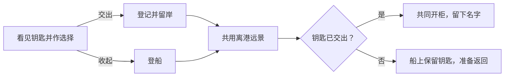

# 《末班渡口》设计说明

这是完整的外部交换格式样例，供学习格式与状态设计。正文以 `screenplay-01.json` 为准。样例尚未导入 Omni Studio，也未生成或试玩实际视频。

## 选择与兑现

玩家扮演林岚，知道钥匙在自己手中。沈叔提前说明留下核对就会错过船，因此选项的眼前代价可辨。交出路线失去当晚离岛的机会，获得共同可查的物品记录；保留路线赶上船，仍拥有钥匙，但柜里的事实没有被查明。结局不自动替父亲洗清行为，也不把未交钥匙写成惩罚性坏结局。

本例只有一个布尔变量 `var_key_disclosed`。选择后保存，汇合时不重置；后面的 `node_route` 实际读取它。`scene_004` 只拍没有可辨人物的渡口远景，因此林岚留岸或上船都与画面相容。近景、钥匙归属和人物所在位置由各自分支完整呈现。

## 两条人工推演路径

| 步骤 | 交出路线 | 保留路线 |
| --- | --- | --- |
| 初始 | var_key_disclosed=false | var_key_disclosed=false |
| 入口选择 | edge_hand 将状态设为 true | edge_keep 明确维持 false |
| 分支内容 | node_hand 播放 scene_002，留岸 | node_keep 播放 scene_003，登船 |
| 汇合 | node_depart 播放 scene_004，状态仍 true | 同一远景，状态仍 false |
| 条件分流 | edge_record 成立 | edge_return 成立 |
| 结局 | node_open / ending_record | node_leave / ending_return |

两条路径都不重放另一条路线的对白。图中条件为布尔精确比较，自动分流无先后顺序依赖。

## 时长与制作量

场次估算秒数依次为 35、20、20、15、35、35。两条路线各经过四场，内容估算均为 105 秒；全部分支正文按六场去重为 160 秒。六个独立视频单元合计估算 160 秒，低于 180 秒预算。玩家等待时间未计入，不能将 105 秒称为实测平均游玩时长。

等待点使用定帧加环境声计划，不要求固定比例的视频尾段循环。共用远景制作一次供两条路线复用。实际生成可能需要重试；重试次数、实际成本与片段无缝衔接需要系统内验收。

## 审阅边界

离线校验命令见包根 README。机器检查能够核对完整文件、正文、引用、可达状态、两个结局和上述统计。自然语言层面仍需评估对白节奏、人物关系可信度及沈叔腕伤表演的一致性；摄制后要重新测量停顿、动作与总时长。
